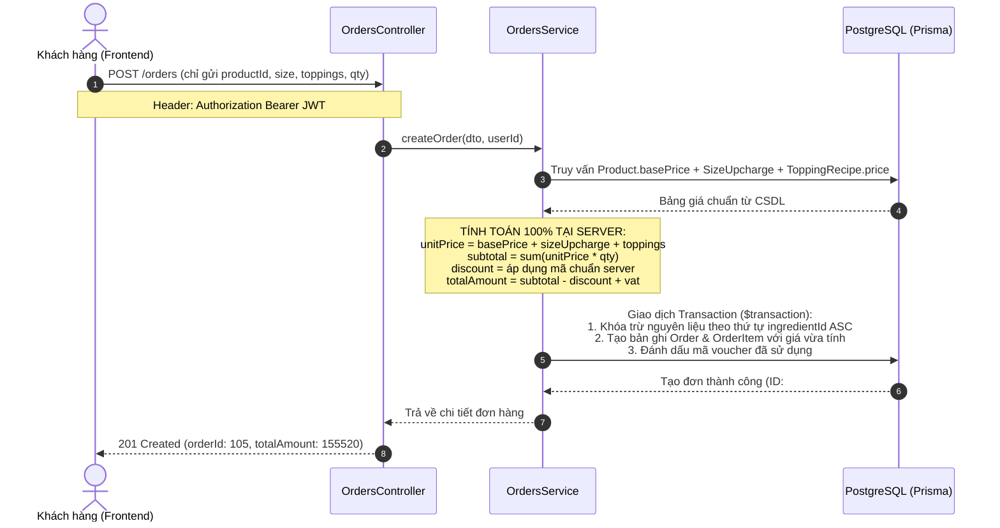
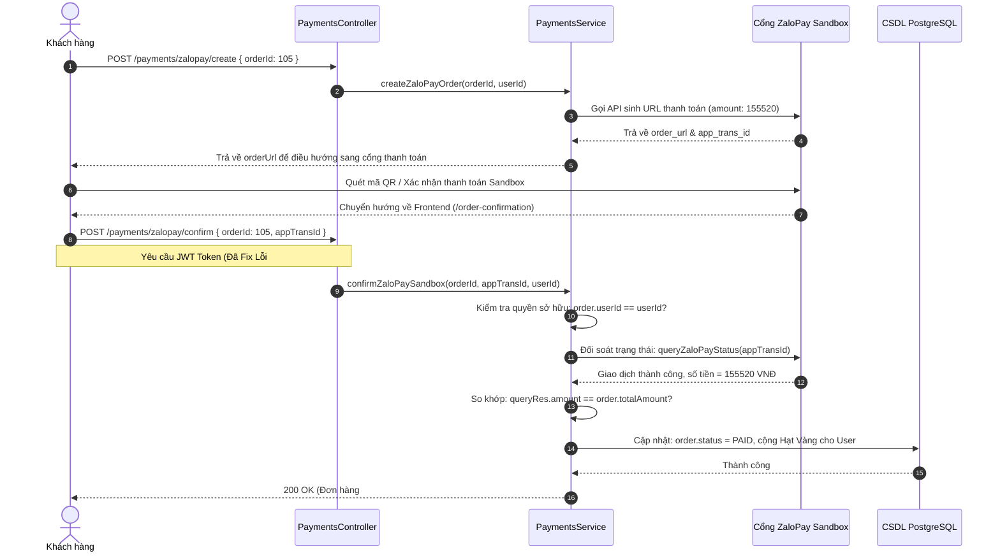

# BÁO CÁO TOÀN DIỆN DANH MỤC API & VÍ DỤ REQUEST/RESPONSE BODY — HỆ THỐNG BREWLITE

> **Kho mã nguồn:** `https://github.com/MaGiaVy/BrewLite.git` (Nhánh: `main` — Commit: `25b2e69`)  
> **Workspace:** `D:\SWE\BrewLite_SWE`  
> **Cập nhật ngày:** 08/11/2026  
> **Tác giả sửa lỗi & thẩm tra:** Mã Gia Vỹ (`3124410414@sv.sgu.edu.vn`)

---

## MỤC LỤC
1. [Tổng quan hệ thống API & Tình trạng khắc phục lỗ hổng](#i-tổng-quan-hệ-thống-api--tình-trạng-khắc-phục-lỗ-hổng)
2. [Chi tiết từng nhóm API kèm Ví dụ Request / Response Body](#ii-chi-tiết-từng-nhóm-api-kèm-ví-dụ-body)
   - [Nhóm 1: Xác thực & Khách hàng Thành viên (Auth & Loyalty)](#1-nhóm-xác-thực--khách-hàng-thành-viên-auth--loyalty)
   - [Nhóm 2: Thực đơn & Món uống (Products & Menu)](#2-nhóm-thực-đơn--món-uống-products--menu)
   - [Nhóm 3: Đặt hàng hoàn toàn dưới Backend (Orders)](#3-nhóm-đặt-hàng-hoàn-toàn-dưới-backend-orders)
   - [Nhóm 4: Cổng thanh toán ZaloPay & Mock Gateway (Payments)](#4-nhóm-cổng-thanh-toán-zalopay--mock-gateway-payments)
   - [Nhóm 5: Quản trị Kho, Định lượng BOM & Voucher (Inventory)](#5-nhóm-quản-trị-kho-định-lượng-bom--voucher-inventory)
   - [Nhóm 6: Quản trị Tài khoản Khách hàng (Admin Customers)](#6-nhóm-quản-trị-tài-khoản-khách-hàng-admin-customers)
   - [Nhóm 7: Quản trị Nhân viên & RBAC (Admin Staff)](#7-nhóm-quản-trị-nhân-viên--rbac-admin-staff)
3. [Sơ đồ luồng hoạt động chuẩn giữa Frontend và Backend](#iii-sơ-đồ-luồng-nghiệp-vụ-chuẩn)
4. [Hướng dẫn chạy kiểm thử tự động & Postman/Thunder Client](#iv-hướng-dẫn-chạy-thử-nghiệm)

---

## I. TỔNG QUAN HỆ THỐNG API & TÌNH TRẠNG KHẮC PHỤC LỖ HỔNG

Hệ thống backend BrewLite (NestJS + Prisma ORM + PostgreSQL) cung cấp **52 API endpoints** được phân chia theo 7 Controller nghiệp vụ chính.

### 1. Thống kê số lượng API theo Method HTTP
- **GET (21 APIs):** Truy vấn dữ liệu thực đơn, chi tiết đơn hàng, lịch sử, danh sách tồn kho, ma trận định lượng BOM, báo cáo dashboard và danh sách người dùng.
- **POST (14 APIs):** Đăng ký, đăng nhập, đổi điểm hạt vàng, tạo đơn hàng (server-side pricing), tạo giao dịch ZaloPay Sandbox, webhook callback, thêm nguyên vật liệu, định lượng, bao bì, nhân viên.
- **PATCH (11 APIs):** Cập nhật hồ sơ cá nhân, đổi mật khẩu, chuyển trạng thái đơn (State Machine Guard), nhập thêm kho, khóa/mở khóa tài khoản khách hàng và nhân viên.
- **PUT (3 APIs):** Cập nhật toàn diện thông tin món uống, công thức định lượng món và định lượng topping.
- **DELETE (3 APIs):** Xóa món, xóa đơn nháp, xóa khách hàng (Smart Delete an toàn).

### 2. Tình trạng 3 Lỗi Trọng Yếu Đã Được Khắc Phục Hoàn Tất
- ✅ **Lỗi 1 (`POST /orders` tin tưởng `unitPrice`):** **ĐÃ KHẮC PHỤC TRIỆT ĐỂ**. `unitPrice` được chuyển thành optional. Backend tự động tính toán lại 100% đơn giá từ DB (`basePrice` + phụ thu size + giá topping từ `ToppingRecipe`). Khách gửi giá 0đ vẫn bị ghi đè thành giá thực tế.
- ✅ **Lỗi 2 (`POST /payments/zalopay/confirm` & `/cancel` thiếu bảo vệ):** **ĐÃ KHẮC PHỤC TRIỆT ĐỂ**. Đã gắn `@UseGuards(JwtAuthGuard)`, kiểm tra sở hữu đơn hàng hoặc quyền `ADMIN`, kiểm tra khớp chính xác số tiền với ZaloPay và chặn tái kích hoạt đơn đã hủy.
- ✅ **Lỗi 3 (`POST /auth/redeem-points` nhận `discountPercent`):** **ĐÃ KHẮC PHỤC TRIỆT ĐỂ**. Loại bỏ hoàn toàn `discountPercent` khỏi payload. Toàn bộ mã giảm giá và số điểm quy đổi được xác thực trên server qua `VOUCHER_CATALOG` và bảng `discountCode`. Dùng lệnh cập nhật khóa nguyên tử chống âm điểm.

---

## II. CHI TIẾT TỪNG NHÓM API KÈM VÍ DỤ BODY

### 1. Nhóm Xác thực & Khách hàng Thành viên (Auth & Loyalty)

#### 1.1 `POST /auth/register` — Đăng ký tài khoản khách hàng mới
- **Mục đích:** Tạo tài khoản khách hàng mới, mã hóa mật khẩu bcrypt (10 rounds), cấp ngay JWT Token và tặng 50 Hạt Vàng chào mừng.
- **Headers:** `Content-Type: application/json`
- **Request Body ví dụ:**
```json
{
  "email": "khachhang_moi@gmail.com",
  "password": "Password123@",
  "fullName": "Nguyễn Văn An",
  "phone": "0901234567"
}
```
- **Response Body mẫu (201 Created):**
```json
{
  "accessToken": "eyJhbGciOiJIUzI1NiIsInR5cCI6IkpXVCJ9...",
  "user": {
    "id": 15,
    "email": "khachhang_moi@gmail.com",
    "fullName": "Nguyễn Văn An",
    "phone": "0901234567",
    "role": "CUSTOMER",
    "loyaltyPoints": 50,
    "createdAt": "2026-11-08T09:00:00.000Z"
  }
}
```

#### 1.2 `POST /auth/login` — Đăng nhập hệ thống
- **Mục đích:** Xác thực email/password cho Khách hàng, Nhân viên quầy (Barista) hoặc Quản trị viên (Admin).
- **Headers:** `Content-Type: application/json`
- **Request Body ví dụ:**
```json
{
  "email": "khachhang_moi@gmail.com",
  "password": "Password123@"
}
```
- **Response Body mẫu (200 OK):**
```json
{
  "accessToken": "eyJhbGciOiJIUzI1NiIsInR5cCI6IkpXVCJ9...",
  "user": {
    "id": 15,
    "email": "khachhang_moi@gmail.com",
    "fullName": "Nguyễn Văn An",
    "phone": "0901234567",
    "role": "CUSTOMER",
    "loyaltyPoints": 50
  }
}
```

#### 1.3 `GET /auth/me` — Lấy thông tin cá nhân & Số dư Hạt Vàng
- **Mục đích:** Lấy thông tin tài khoản hiện tại, số dư điểm thưởng để hiển thị tại Loyalty Drawer.
- **Headers:** `Authorization: Bearer <accessToken>`
- **Request Body:** Không có (GET)
- **Response Body mẫu (200 OK):**
```json
{
  "id": 15,
  "email": "khachhang_moi@gmail.com",
  "fullName": "Nguyễn Văn An",
  "phone": "0901234567",
  "role": "CUSTOMER",
  "loyaltyPoints": 50,
  "createdAt": "2026-11-08T09:00:00.000Z"
}
```

#### 1.4 `PATCH /auth/profile` — Cập nhật hồ sơ & Đổi mật khẩu
- **Mục đích:** Khách hàng chỉnh sửa họ tên, số điện thoại hoặc đổi mật khẩu mới (yêu cầu mật khẩu hiện tại).
- **Headers:** `Authorization: Bearer <accessToken>`, `Content-Type: application/json`
- **Request Body ví dụ:**
```json
{
  "fullName": "Nguyễn Văn An (VIP)",
  "phone": "0909888999",
  "currentPassword": "Password123@",
  "newPassword": "NewPassword456@"
}
```
- **Response Body mẫu (200 OK):**
```json
{
  "id": 15,
  "email": "khachhang_moi@gmail.com",
  "fullName": "Nguyễn Văn An (VIP)",
  "phone": "0909888999",
  "role": "CUSTOMER",
  "isActive": true,
  "loyaltyPoints": 50
}
```

#### 1.5 `POST /auth/redeem-points` — Đổi Hạt Vàng lấy Voucher giảm giá *(Đã Fix)*
- **Mục đích:** Trừ điểm Hạt Vàng an toàn bằng Atomic Lock và cấp mã Voucher giảm giá vào ví voucher của khách hàng.
- **Bảo mật:** Client **chỉ được gửi số điểm và mã voucher muốn đổi**. Server tự tra cứu % giảm giá từ danh mục chuẩn.
- **Headers:** `Authorization: Bearer <accessToken>`, `Content-Type: application/json`
- **Request Body ví dụ:**
```json
{
  "points": 20,
  "voucherCode": "BREW20",
  "description": "Đổi 20 Hạt Vàng lấy voucher giảm 20%"
}
```
- **Response Body mẫu (200 OK):**
```json
{
  "success": true,
  "message": "Đổi 20 Hạt Vàng lấy mã BREW20 thành công!",
  "remainingPoints": 30,
  "voucher": {
    "id": 8,
    "userId": 15,
    "code": "BREW20",
    "discountPercent": 20,
    "minOrderAmount": 80000,
    "quantity": 1
  }
}
```

#### 1.6 `GET /auth/vouchers` — Lấy danh sách Voucher người dùng đang sở hữu
- **Headers:** `Authorization: Bearer <accessToken>`
- **Response Body mẫu (200 OK):**
```json
[
  {
    "id": 8,
    "code": "BREW20",
    "quantity": 1,
    "discountPercent": 20,
    "minOrderAmount": 80000
  }
]
```

---

### 2. Nhóm Thực đơn & Món uống (Products & Menu)

#### 2.1 `GET /products` — Danh sách món uống cho Menu khách hàng *(Đã Fix)*
- **Mục đích:** Khách hàng duyệt danh sách món.
- **Bảo mật:** Hệ thống tự động **lược bỏ bí mật công thức `recipes`, giá vốn `cogs` và `margin`** nếu không phải tài khoản `ADMIN`.
- **Headers:** Không yêu cầu (hoặc có Bearer token nếu đã đăng nhập)
- **Response Body mẫu (200 OK - Khách thường):**
```json
[
  {
    "id": 1,
    "name": "Cà phê Muối Hoàng Gia",
    "basePrice": 35000,
    "sizeUpchargeM": 5000,
    "sizeUpchargeL": 10000,
    "imageUrl": "/images/products/ca-phe-muoi.png",
    "description": "Cà phê Robusta đậm đà kết hợp lớp kem béo mặn đặc trưng",
    "category": "vietnamese",
    "isOutOfStock": false,
    "availableServings": 45
  }
]
```

#### 2.2 `POST /products` — Thêm món uống mới vào Menu (Chỉ Quản trị viên)
- **Headers:** `Authorization: Bearer <adminToken>`, `Content-Type: application/json`
- **Request Body ví dụ:**
```json
{
  "name": "Trà Đào Cam Sả Đặc Biệt",
  "category": "tea",
  "basePrice": 39000,
  "sizeUpchargeM": 6000,
  "sizeUpchargeL": 12000,
  "description": "Hương vị trà đen đậm kết hợp đào thanh mát và sả tươi",
  "imageUrl": "/images/products/tra-dao.png",
  "isActive": true
}
```
- **Response Body mẫu (201 Created):**
```json
{
  "id": 12,
  "name": "Trà Đào Cam Sả Đặc Biệt",
  "basePrice": 39000,
  "category": "tea",
  "isActive": true,
  "createdAt": "2026-11-08T09:10:00.000Z"
}
```

---

### 3. Nhóm Đặt hàng hoàn toàn dưới Backend (Orders)

#### 3.1 `POST /orders` — Đặt hàng hoàn toàn dưới Backend *(Đã Fix Trọng Yếu)*
- **Mục đích:** Tạo đơn hàng mới từ giỏ hàng.
- **Cơ chế An toàn:**
  - Client chỉ truyền: `productId`, `size`, `toppings`, `quantity`, `discountCode`.
  - Backend tự động truy vấn giá gốc từ bảng `Product`, phụ thu size (`sizeUpchargeM/L`), và bảng giá Topping từ `ToppingRecipe`.
  - Backend tự tính:
    $$\text{Đơn giá 1 ly} = \text{Base Price} + \text{Phụ thu Size} + \sum \text{Giá Toppings}$$
    $$\text{Subtotal} = \sum (\text{Đơn giá 1 ly} \times \text{Số lượng})$$
    $$\text{Tổng tiền} = \text{Subtotal} - \text{Discount} + \text{VAT (8\%)}$$
  - Trừ kho nguyên vật liệu tương ứng (BOM) bằng khóa tuần tự chống Deadlock.
- **Headers:** `Authorization: Bearer <customerToken>`, `Content-Type: application/json`
- **Request Body ví dụ (Client gọi):**
```json
{
  "items": [
    {
      "productId": 1,
      "productName": "Cà phê Muối Hoàng Gia",
      "size": "L",
      "toppings": ["Trân châu hoàng kim", "Kem Cheese"],
      "quantity": 2
    },
    {
      "productId": 2,
      "productName": "Trà Sữa Oolong Nướng",
      "size": "M",
      "toppings": ["Thạch sương sáo"],
      "quantity": 1
    }
  ],
  "discountCode": "BREW10"
}
```
- **Response Body mẫu (201 Created):**
```json
{
  "orderId": 105,
  "status": "PENDING",
  "rawSubtotal": 159000,
  "discountAmount": 15000,
  "vatAmount": 11520,
  "totalAmount": 155520,
  "items": [
    {
      "id": 201,
      "productId": 1,
      "productName": "Cà phê Muối Hoàng Gia",
      "size": "L",
      "unitPrice": 53000,
      "quantity": 2
    },
    {
      "id": 202,
      "productId": 2,
      "productName": "Trà Sữa Oolong Nướng",
      "size": "M",
      "unitPrice": 53000,
      "quantity": 1
    }
  ],
  "createdAt": "2026-11-08T09:15:00.000Z"
}
```

#### 3.2 `GET /orders/me` — Lịch sử đơn hàng của tôi
- **Headers:** `Authorization: Bearer <customerToken>`
- **Response Body mẫu (200 OK):**
```json
[
  {
    "id": 105,
    "status": "PAID",
    "totalAmount": 155520,
    "createdAt": "2026-11-08T09:15:00.000Z",
    "items": [
      {
        "productName": "Cà phê Muối Hoàng Gia",
        "size": "L",
        "quantity": 2,
        "unitPrice": 53000
      }
    ]
  }
]
```

#### 3.3 `GET /orders/barista/queue` — Hàng đợi đơn hàng cho Màn hình Barista KDS (`/staff`)
- **Phân quyền:** Dành riêng cho `STAFF` và `ADMIN`.
- **Headers:** `Authorization: Bearer <staffToken>`
- **Response Body mẫu (200 OK kèm định lượng nguyên liệu tức thời):**
```json
[
  {
    "id": 105,
    "status": "PAID",
    "totalAmount": 155520,
    "items": [
      {
        "productId": 1,
        "productName": "Cà phê Muối Hoàng Gia",
        "size": "L",
        "quantity": 2,
        "toppings": ["Trân châu hoàng kim", "Kem Cheese"]
      }
    ]
  }
]
```

#### 3.4 `PATCH /orders/:id/status` — Cập nhật trạng thái đơn hàng *(Đã Fix Trọng Yếu)*
- **Quy tắc phân quyền:**
  - Khách hàng (`CUSTOMER`): **Chỉ được phép tự hủy đơn (`status: "CANCELLED"`)** khi đơn đang ở trạng thái `PENDING`. Mọi cố gắng chuyển sang `PAID` đều bị từ chối với `403 Forbidden`.
  - Nhân viên/Admin (`STAFF`/`ADMIN`): Chuyển trạng thái theo đúng State Machine `PAID -> PREPARING -> READY -> COMPLETED`.
- **Headers:** `Authorization: Bearer <token>`, `Content-Type: application/json`
- **Request Body ví dụ (Barista bấm Nhận Đơn):**
```json
{
  "status": "PREPARING"
}
```
- **Response Body mẫu (200 OK):**
```json
{
  "id": 105,
  "status": "PREPARING",
  "staffId": 2,
  "staffName": "Trần Thị Barista",
  "updatedAt": "2026-11-08T09:16:30.000Z"
}
```

---

### 4. Nhóm Cổng thanh toán ZaloPay & Mock Gateway (Payments)

#### 4.1 `POST /payments/zalopay/create` — Tạo đơn hàng thanh toán qua ZaloPay
- **Mục đích:** Sinh URL cổng thanh toán ZaloPay Gateway hoặc QR Code.
- **Headers:** `Authorization: Bearer <customerToken>`, `Content-Type: application/json`
- **Request Body ví dụ:**
```json
{
  "orderId": 105,
  "method": "ZALOPAY"
}
```
- **Response Body mẫu (201 Created):**
```json
{
  "orderId": 105,
  "appTransId": "261108_105_738291",
  "orderUrl": "https://qcgateway.zalopay.vn/pay?token=a1b2c3d4...",
  "zpTransToken": "a1b2c3d4...",
  "qrCode": "data:image/png;base64,iVBORw0KGgo...",
  "amount": 155520
}
```

#### 4.2 `POST /payments/zalopay/confirm` — Xác nhận thanh toán Sandbox *(Đã Fix Trọng Yếu)*
- **Bảo mật:** Bắt buộc có `JwtAuthGuard`. Chỉ chủ sở hữu đơn hàng hoặc `ADMIN` mới được xác nhận. So khớp đúng `amount` trên gateway.
- **Headers:** `Authorization: Bearer <customerToken>`, `Content-Type: application/json`
- **Request Body ví dụ:**
```json
{
  "orderId": 105,
  "appTransId": "261108_105_738291"
}
```
- **Response Body mẫu (200 OK):**
```json
{
  "success": true,
  "orderId": 105,
  "status": "PAID",
  "earnedPoints": 155,
  "message": "Thanh toán thành công qua ZaloPay. Đã cộng 155 Hạt Vàng."
}
```

#### 4.3 `POST /payments/zalopay/cancel` — Hủy thanh toán từ cổng Gateway *(Đã Fix Trọng Yếu)*
- **Headers:** `Authorization: Bearer <customerToken>`, `Content-Type: application/json`
- **Request Body ví dụ:**
```json
{
  "orderId": 105
}
```
- **Response Body mẫu (200 OK):**
```json
{
  "success": true,
  "orderId": 105,
  "status": "PAYMENT_FAILED",
  "message": "Giao dịch thanh toán đã bị hủy bởi người dùng."
}
```

#### 4.4 `POST /payments/zalopay/callback` — Webhook nhận kết quả từ Server ZaloPay
- **Bảo mật:** Kiểm tra chữ ký số HMAC-SHA256 (`mac`). Trả về kết quả xử lý Idempotent.
- **Headers:** `Content-Type: application/json`
- **Request Body ví dụ (ZaloPay Server gửi sang):**
```json
{
  "data": "{\"app_id\":2553,\"app_trans_id\":\"261108_105_738291\",\"amount\":155520,\"zp_trans_id\":240101000000001}",
  "mac": "8a3d548f0e4b85c39dc0d52..."
}
```
- **Response Body mẫu (200 OK trả về cho ZaloPay):**
```json
{
  "return_code": 1,
  "return_message": "success"
}
```

---

### 5. Nhóm Quản trị Kho, Định lượng BOM & Voucher (Inventory)

#### 5.1 `GET /inventory/recipes` — Ma trận Định lượng BOM *(Đã Bảo Vệ)*
- **Bảo mật:** Bắt buộc quyền `ADMIN` (`@Roles(Role.ADMIN)`).
- **Headers:** `Authorization: Bearer <adminToken>`
- **Response Body mẫu (200 OK):**
```json
[
  {
    "id": 1,
    "productId": 1,
    "productName": "Cà phê Muối Hoàng Gia",
    "size": "M",
    "ingredientId": 10,
    "ingredientName": "Hạt Cà phê Robusta",
    "amount": 25.0,
    "unit": "g"
  },
  {
    "id": 2,
    "productId": 1,
    "productName": "Cà phê Muối Hoàng Gia",
    "size": "M",
    "ingredientId": 12,
    "ingredientName": "Sốt Kem Muối Biển",
    "amount": 35.0,
    "unit": "ml"
  }
]
```

#### 5.2 `POST /inventory/recipes` — Thêm / Cập nhật định lượng món (BOM)
- **Validation:** Bắt buộc `size` thuộc `['S', 'M', 'L', 'ALL']`.
- **Headers:** `Authorization: Bearer <adminToken>`, `Content-Type: application/json`
- **Request Body ví dụ:**
```json
{
  "productId": 1,
  "ingredientId": 10,
  "size": "L",
  "amount": 30.0
}
```
- **Response Body mẫu (201 Created):**
```json
{
  "id": 3,
  "productId": 1,
  "ingredientId": 10,
  "size": "L",
  "amount": 30.0
}
```

#### 5.3 `PATCH /inventory/ingredients/:id/restock` — Nhập thêm kho nguyên liệu
- **Headers:** `Authorization: Bearer <adminToken>`, `Content-Type: application/json`
- **Request Body ví dụ:**
```json
{
  "quantity": 5000,
  "costPerUnit": 180,
  "supplier": "Nông trại Robusta Đắk Lắk",
  "note": "Nhập kho định kỳ đầu tháng"
}
```
- **Response Body mẫu (200 OK):**
```json
{
  "id": 10,
  "name": "Hạt Cà phê Robusta",
  "stock": 15000,
  "unit": "g",
  "costPerUnit": 180,
  "lastRestockedAt": "2026-11-08T09:20:00.000Z"
}
```

#### 5.4 `DELETE /inventory/ingredients/:id` — Xóa nguyên liệu kho *(Đã Chống Cascade Delete)*
- **Bảo vệ:** Nếu nguyên liệu đang nằm trong công thức món, hệ thống từ chối xóa và ném `409 Conflict`.
- **Headers:** `Authorization: Bearer <adminToken>`
- **Response khi có lỗi ràng buộc (409 Conflict):**
```json
{
  "statusCode": 409,
  "message": "Không thể xóa nguyên liệu vì đang được sử dụng trong công thức món. Vui lòng gỡ khỏi công thức trước."
}
```

#### 5.5 `GET /inventory/dashboard` — Thống kê Quản trị Doanh thu & Tồn kho
- **Bảo mật:** Dành riêng cho `ADMIN` (`@Roles(Role.ADMIN)`).
- **Headers:** `Authorization: Bearer <adminToken>`
- **Response Body mẫu (200 OK):**
```json
{
  "totalRevenue": 45890000,
  "totalOrders": 320,
  "totalCogs": 16500000,
  "grossProfit": 29390000,
  "grossMarginPercent": 64.04,
  "lowStockIngredientsCount": 2,
  "activeCustomersCount": 180
}
```

---

### 6. Nhóm Quản trị Tài khoản Khách hàng (Admin Customers)

#### 6.1 `GET /admin/customers` — Danh sách khách hàng kèm số dư Hạt Vàng
- **Headers:** `Authorization: Bearer <adminToken>`
- **Response Body mẫu (200 OK):**
```json
[
  {
    "id": 15,
    "email": "khachhang_moi@gmail.com",
    "fullName": "Nguyễn Văn An",
    "phone": "0901234567",
    "loyaltyPoints": 155,
    "totalOrders": 3,
    "totalSpent": 320000,
    "isActive": true
  }
]
```

#### 6.2 `PATCH /admin/customers/:id/status` — Khóa / Mở khóa tài khoản khách hàng
- **Bảo vệ:** Cưỡng chế lọc `role: Role.CUSTOMER`, cấm khóa Root Admin (`admin@brewlite.vn`).
- **Headers:** `Authorization: Bearer <adminToken>`, `Content-Type: application/json`
- **Request Body ví dụ:**
```json
{
  "isActive": false,
  "reason": "Phát hiện hành vi spam đơn hàng ảo"
}
```
- **Response Body mẫu (200 OK):**
```json
{
  "id": 15,
  "email": "khachhang_moi@gmail.com",
  "isActive": false,
  "updatedAt": "2026-11-08T09:25:00.000Z"
}
```

#### 6.3 `DELETE /admin/customers/:id` — Xóa tài khoản khách hàng (Smart Delete)
- **Bảo mật:** Chỉ xóa khi user có `role: Role.CUSTOMER`. Nếu khách đã có đơn hàng thì chuyển sang Soft-Delete (`isActive = false`), nếu chưa có đơn hàng thì xóa an toàn khỏi DB. Tuyệt đối không xóa nhầm Admin.
- **Headers:** `Authorization: Bearer <adminToken>`
- **Response Body mẫu (200 OK):**
```json
{
  "success": true,
  "message": "Đã vô hiệu hóa tài khoản khách hàng và bảo lưu toàn bộ lịch sử đơn hàng."
}
```

---

### 7. Nhóm Quản trị Nhân viên & RBAC (Admin Staff)

#### 7.1 `POST /admin/staff` — Thêm nhân viên quầy mới
- **Phân quyền:** Chỉ Quản trị viên mới có quyền tạo nhân viên.
- **Headers:** `Authorization: Bearer <adminToken>`, `Content-Type: application/json`
- **Request Body ví dụ:**
```json
{
  "email": "barista_minh@brewlite.vn",
  "password": "StaffPassword123@",
  "fullName": "Quách Kỳ Minh",
  "phone": "0911223344",
  "role": "STAFF"
}
```
- **Response Body mẫu (201 Created):**
```json
{
  "id": 22,
  "email": "barista_minh@brewlite.vn",
  "fullName": "Quách Kỳ Minh",
  "phone": "0911223344",
  "role": "STAFF",
  "isActive": true,
  "createdAt": "2026-11-08T09:30:00.000Z"
}
```

#### 7.2 `DELETE /admin/staff/:id` — Xóa tài khoản nhân viên
- **Quy tắc an toàn:**
  - Không thể xóa Root Admin (`admin@brewlite.vn`).
  - Quản trị viên không thể tự xóa chính mình (`id === currentAdminId`).
  - Luôn đảm bảo tối thiểu còn 1 tài khoản `ADMIN` trong hệ thống.
- **Headers:** `Authorization: Bearer <adminToken>`
- **Response Body mẫu (200 OK):**
```json
{
  "success": true,
  "message": "Đã xóa tài khoản nhân viên thành công."
}
```

---

## III. SƠ ĐỒ LUỒNG NGHIỆP VỤ CHUẨN

### 1. Luồng Đặt hàng hoàn toàn dưới Backend (Server-side Pricing Flow)



---

### 2. Luồng Thanh toán Cổng ZaloPay Sandbox An toàn



---

## IV. HƯỚNG DẪN CHẠY THỬ NGHIỆM

### 1. Chạy toàn bộ Test tự động (Automated Tests)
Mở terminal tại thư mục gốc của dự án:
```bash
# Chạy toàn bộ 183 unit tests backend
npm --prefix backend test

# Kiểm tra bản build production backend (NestJS)
npm --prefix backend run build

# Kiểm tra bản build frontend (Next.js)
npm --prefix frontend run build
```

### 2. Kiểm tra nhanh bằng cURL hoặc Postman

#### Bước 1: Đăng nhập lấy Token
```bash
curl -X POST http://localhost:3001/auth/login \
  -H "Content-Type: application/json" \
  -d '{"email":"admin@brewlite.vn","password":"AdminPassword123@"}'
```

#### Bước 2: Tạo đơn hàng thử nghiệm (Server tự tính giá)
```bash
curl -X POST http://localhost:3001/orders \
  -H "Authorization: Bearer <accessToken>" \
  -H "Content-Type: application/json" \
  -d '{
    "items": [
      {
        "productId": 1,
        "productName": "Cà phê Muối Hoàng Gia",
        "size": "L",
        "quantity": 1,
        "unitPrice": 0
      }
    ]
  }'
```
> **Kết quả mong đợi:** Trường `unitPrice: 0` từ client hoàn toàn bị bỏ qua; server tự động tính toán và trả về đúng đơn giá thực tế từ cơ sở dữ liệu kèm chi tiết thành tiền.
