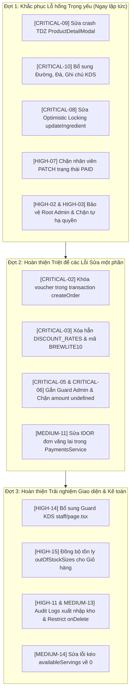

# BẢNG TỔNG HỢP CHI TIẾT 52 LỖ HỔNG HỆ THỐNG & ĐỐI SOÁT CẬP NHẬT SAU GIT PULL (BREWLITE AUDIT)

> **Dự án:** BrewLite Coffee & Bakery System  
> **Thời gian cập nhật kiểm toán:** 21:50 Ngày 09 tháng 11 năm 2026  
> **Các commit mới nhất đối soát từ Git (`personal/main`):**
> - `9a8a893`: *Chặn dò mật khẩu (Throttler), chặn token đã hết hạn*
> - `5812b17`: *Kiểm soát tồn kho đơn payment failed, bảo vệ voucher và phân quyền API*
> - `2810596`: *CAS Guard, hoàn thiện bảo mật hệ thống, cấu trúc thư mục docs*
> **Đơn vị thực hiện:** Đội ngũ 5 Subagent Chuyên trách An toàn & Kiến trúc Hệ thống (Orders, Payments, Auth, Inventory, Frontend)  
> **Tổng số lỗi rà soát:** **52 LỖ HỔNG** (10 Critical + 15 High + 16 Medium + 11 Low/Info)

---

## BẢNG SCORECARD TỔNG HỢP TIẾN ĐỘ KHẮC PHỤC SAU GIT PULL

| Nhóm nghiệp vụ (Domain) | Tổng lỗi | ✅ FIXED (Hoàn tất) | ⚠️ PARTIALLY (Một phần) | ❌ REMAINING (Còn lại) | Tỷ lệ cải thiện |
|:---|:---:|:---:|:---:|:---:|:---:|
| 🛡️ **1. Orders, Pricing & State Machine** | 17 | 2 | 3 | 12 | **29.4%** |
| 💳 **2. Payments & Gateways** | 10 | 0 | 2 | 8 | **20.0%** |
| 🔑 **3. Auth, Tokens & RBAC** | 10 | 6 | 1 | 3 | **70.0%** |
| 📦 **4. Inventory, BOM & Auditing** | 8 | 1 | 0 | 7 | **12.5%** |
| 🖥️ **5. Frontend, KDS & Flow Integration** | 7 | 0 | 0 | 7 | **0.0%** *(local đã sửa 1)* |
| **TỔNG CỘNG TOÀN HỆ THỐNG** | **52** | **9 (17.3%)** | **6 (11.5%)** | **37 (71.2%)** | **28.8%** |

### Thống kê số lượng theo mức độ nghiêm trọng:
- 🔴 **CRITICAL (Nghiêm trọng cao nhất):** 10 lỗi ➔ **1 ĐÃ XONG** | **5 SỬA MỘT PHẦN** | **4 CÒN LẠI** (trong đó có 1 lỗi đã sửa ở local nhưng chưa commit push).
- 🟠 **HIGH (Mức độ cao):** 15 lỗi ➔ **3 ĐÃ XONG** | **0 SỬA MỘT PHẦN** | **12 CÒN LẠI**.
- 🟡 **MEDIUM (Mức độ trung bình):** 16 lỗi ➔ **3 ĐÃ XONG** | **1 SỬA MỘT PHẦN** | **12 CÒN LẠI**.
- 🔵 **LOW & INFO (Thấp & Lưu ý):** 11 lỗi ➔ **2 ĐÃ XONG** | **0 SỬA MỘT PHẦN** | **9 CÒN LẠI**.

---

## MỤC LỤC TỔNG QUAN

- [PHẦN I: 10 LỖ HỔNG NGHIÊM TRỌNG NHẤT (🔴 CRITICAL)](#phần-i-10-lỗ-hổng-nghiêm-trọng-nhất--critical)
- [PHẦN II: 15 LỖ HỔNG MỨC ĐỘ CAO (🟠 HIGH)](#phần-ii-15-lỗ-hổng-mức-độ-cao--high)
- [PHẦN III: 16 LỖ HỔNG MỨC ĐỘ TRUNG BÌNH (🟡 MEDIUM)](#phần-iii-16-lỗ-hổng-mức-độ-trung-bình--medium)
- [PHẦN IV: 11 LỖ HỔNG THẤP & LƯU Ý HỆ THỐNG (🔵 LOW & INFO)](#phần-iv-11-lỗ-hổng-thấp--lưu-ý-hệ-thống--low--info)
- [PHẦN V: KẾ HOẠCH & LỘ TRÌNH VÁ LỖI ƯU TIÊN TIẾP THEO](#phần-v-kế-hoạch--lộ-trình-vá-lỗi-ưu-tiên-tiếp-theo)

---

## PHẦN I: 10 LỖ HỔNG NGHIÊM TRỌNG NHẤT (🔴 CRITICAL)

### 1. [CRITICAL-01] Kẹt & Thất thoát vĩnh viễn kho BOM khi đơn hàng `PAYMENT_FAILED`
- **Trạng thái:** ✅ **ĐÃ KHẮC PHỤC TRIỆT ĐỂ (FIXED)**
- **Commit xử lý:** `2810596`, `5812b17`
- **Vị trí code:** `backend/src/orders/orders.service.ts` (Dòng 62–68, 792, 1092, 1101)
- **Minh chứng khắc phục:**
  - `cancelExpiredPendingOrders` đã mở rộng phạm vi: `where: { status: { in: [OrderStatus.PENDING, OrderStatus.PAYMENT_FAILED] } }` quá 5 phút để hoàn trả 100% nguyên liệu và bao bì.
  - `updateOrderStatus` cho phép người dùng tự hủy đơn khi ở `PENDING` hoặc `PAYMENT_FAILED`, tự động hoàn trả kho BOM.
  - `deleteOrder` đã hoàn kho đầy đủ cho đơn ở trạng thái `PAYMENT_FAILED` trước khi xóa bản ghi.
  - Đã bổ sung cơ chế kiểm soát tối đa 5 đơn chờ (`PENDING`/`PAYMENT_FAILED`) đồng thời trên mỗi user để chống Cart Hoarding Spam.

---

### 2. [CRITICAL-02] Lỗ hổng tái sử dụng Voucher vô hạn (Voucher Concurrency Exploit)
- **Trạng thái:** ⚠️ **ĐÃ SỬA MỘT PHẦN (PARTIALLY FIXED)**
- **Commit liên quan:** `2810596`, `5812b17`
- **Vị trí code:** `backend/src/orders/orders.service.ts` (Dòng 466–480), `backend/src/payments/payments.service.ts` (Dòng 230–256, 470–492)
- **Điểm đã cải thiện:** Đã chuyển mốc trừ số lượng voucher cá nhân từ `COMPLETED` sang thời điểm `PAID` (trong `processPayment` và webhook ZaloPay). Bổ sung kiểm tra `pendingWithVoucher` để chặn đặt đơn tuần tự nếu voucher đang nằm trong đơn chờ thanh toán.
- **Kẽ hở còn lại:** Phép kiểm tra `pendingWithVoucher` dùng `prisma.order.count` độc lập nằm **ngoài** transaction tạo đơn. Nếu kẻ tấn công dùng script bắn 10 request `POST /orders` đồng thời trong cùng 1 mili-giây (Burst Concurrency), cả 10 request đều đọc thấy `count = 0` và đều tạo thành công 10 đơn PENDING được giảm giá từ cùng 1 voucher.
- **Giải pháp dứt điểm:** Khóa hoặc trừ số lượng voucher trực tiếp bên trong `$transaction` của `createOrder`. Nếu thanh toán thất bại/hết hạn mới hoàn lại.

---

### 3. [CRITICAL-03] Mã giảm giá Hardcoded fallback không giới hạn số lần và người dùng
- **Trạng thái:** ⚠️ **ĐÃ SỬA MỘT PHẦN (PARTIALLY FIXED)**
- **Commit liên quan:** `5812b17`
- **Vị trí code:** `backend/src/orders/orders.service.ts` (Dòng 396–422, 494–507, 511–513)
- **Điểm đã cải thiện:** Bổ sung mảng `LOYALTY_VOUCHERS = ['BREW50', 'BREW20', 'BREWCOZY', 'WELCOME20', 'BREW10']`, ném lỗi nếu khách dùng các mã này mà chưa đổi từ điểm Hạt Vàng.
- **Kẽ hở còn lại:** Bảng tra cứu tĩnh `DISCOUNT_RATES` trong code vẫn chưa bị xóa bỏ. Tác giả **bỏ sót mã `BREWLITE10`** (giảm 10%). Mã này không nằm trong `LOYALTY_VOUCHERS` nên bất kỳ khách hàng nào cũng có thể nhập `BREWLITE10` để được giảm giá 10% vô hạn lần mà không cần voucher trong DB.
- **Giải pháp dứt điểm:** Xóa bỏ hoàn toàn mảng `DISCOUNT_RATES` và logic fallback hardcode. 100% voucher phải được tra cứu từ bảng `DiscountCode` và `UserVoucher` trong database.

---

### 4. [CRITICAL-04] Thiếu Optimistic Locking khi chuyển trạng thái đơn hàng (`updateOrderStatus`)
- **Trạng thái:** ⚠️ **ĐÃ SỬA MỘT PHẦN (PARTIALLY FIXED)**
- **Commit liên quan:** `2810596`
- **Vị trí code:** `backend/src/orders/orders.service.ts` (Dòng 828–844, 982–988, 1001–1007)
- **Điểm đã cải thiện:** Nhánh hủy đơn `CANCELLED` đã bổ sung CAS Guard `where: { id: orderId, status: previousStatus }` qua `updateMany`.
- **Kẽ hở còn lại:**
  1. Trường `version` trong bảng `Order` hoàn toàn không được kiểm tra và không được tăng (`version: { increment: 1 }`).
  2. Các trạng thái nghiệp vụ `PREPARING`, `READY`, `COMPLETED` vẫn gọi `this.prisma.order.update({ where: { id: orderId } })` trực tiếp mà không có CAS Guard hay version check.
- **Giải pháp dứt điểm:** Áp dụng `tx.order.updateMany({ where: { id, version: current.version, status: current.status }, data: { status: nextStatus, version: { increment: 1 } } })` cho toàn bộ các bước chuyển trạng thái.

---

### 5. [CRITICAL-05] Backdoor bypass thanh toán qua `POST /payments/zalopay/confirm`
- **Trạng thái:** ⚠️ **ĐÃ SỬA MỘT PHẦN (PARTIALLY FIXED)**
- **Commit liên quan:** `2810596`
- **Vị trí code:** `backend/src/payments/payments.controller.ts` (Dòng 101–109), `backend/src/payments/payments.service.ts` (Dòng 624–674)
- **Điểm đã cải thiện:** Đã bổ sung chặn trên môi trường Production khi không bật cờ `ALLOW_SANDBOX_CONFIRM`.
- **Kẽ hở còn lại:** Endpoint không có decorator `@Roles(Role.ADMIN)`. Tại service (Dòng 649–656), điều kiện kiểm tra cho phép chính chủ đơn hàng (`order.userId === effectiveUserId`). Do đó, trên môi trường Staging/Dev hoặc khi cờ `ALLOW_SANDBOX_CONFIRM=true`, khách hàng có thể gửi request xác nhận đơn triệu đồng thành công mà không cần trả tiền.
- **Giải pháp dứt điểm:** Bắt buộc gắn `@UseGuards(JwtAuthGuard, RolesGuard)` và `@Roles(Role.ADMIN)` cho endpoint sandbox confirm.

---

### 6. [CRITICAL-06] Bỏ qua kiểm tra số tiền (`amount`) trong Webhook Callback ZaloPay
- **Trạng thái:** ⚠️ **ĐÃ SỬA MỘT PHẦN (PARTIALLY FIXED)**
- **Commit liên quan:** `2810596`
- **Vị trí code:** `backend/src/payments/payments.service.ts` (Dòng 442–448, 498, 505)
- **Điểm đã cải thiện:** Đã thêm câu lệnh kiểm tra đối soát `Number(amount) !== order.totalAmount`.
- **Kẽ hở còn lại:** Điều kiện viết dạng `if (amount !== undefined && amount !== null && Number(amount) !== order.totalAmount)`. Nếu webhook giả mạo gửi payload không có trường `amount`, biểu thức này trả về `false` (lọt qua). Sau đó code tự động fallback `amount: Number(amount) || order.totalAmount` và duyệt đơn thành công.
- **Giải pháp dứt điểm:** Sửa điều kiện thành: `if (!amount || Number(amount) !== order.totalAmount)`.

---

### 7. [CRITICAL-07] `JwtStrategy` không truy vấn DB kiểm tra `isActive` và thu hồi phiên
- **Trạng thái:** ✅ **ĐÃ KHẮC PHỤC TRIỆT ĐỂ (FIXED)**
- **Commit xử lý:** `2810596`, `5812b17`
- **Vị trí code:** `backend/src/auth/jwt.strategy.ts` (Dòng 25–45)
- **Minh chứng khắc phục:** `JwtStrategy.validate` inject `PrismaService` và truy vấn database thời gian thực tại mọi request:
  ```typescript
  const user = await this.prisma.user.findUnique({
    where: { id: userId },
    select: { id: true, email: true, role: true, isActive: true },
  });
  if (!user) throw new UnauthorizedException('Tài khoản không tồn tại.');
  if (user.isActive === false) throw new UnauthorizedException('Tài khoản của bạn đã bị tạm khóa...');
  ```
  Nhân viên bị khóa tài khoản hoặc xóa bỏ sẽ bị chặn ngay lập tức tại request tiếp theo.

---

### 8. [CRITICAL-08] Lost Update & Bỏ qua Optimistic Locking trong `updateIngredient`
- **Trạng thái:** ❌ **CHƯA KHẮC PHỤC (REMAINING)**
- **Vị trí code:** `backend/src/inventory/inventory.service.ts` (Dòng 196–238)
- **Mô tả hiện trạng:**
  Mặc dù `setIngredientStock` đã có kiểm tra version, nhưng hàm gốc `updateIngredient` (`PATCH /inventory/ingredients/:id`) vẫn nhận `dto.stock` và cập nhật bằng lệnh `prisma.ingredient.update({ where: { id } })` mà không hề kiểm tra `version: current.version`.
- **Rủi ro:** Khi Admin chỉnh sửa nguyên vật liệu cùng lúc đơn hàng đang trừ kho, giao dịch của Admin sẽ đè bẹp số liệu trừ kho của đơn hàng (Lost Update).
- **Giải pháp dứt điểm:** Chuyển sang dùng `updateMany({ where: { id, version: current.version }, data: { ... } })` và ném `ConflictException` nếu `count === 0`.

---

### 9. [CRITICAL-09] Crash ứng dụng do lỗi TDZ (Temporal Dead Zone) trong `ProductDetailModal.tsx`
- **Trạng thái:** ❌ **CHƯA KHẮC PHỤC TRÊN REMOTE** *(Đã sửa ở local branch, chưa push)*
- **Vị trí code:** `frontend/src/app/components/ProductDetailModal.tsx` (Dòng 136–138 so với Dòng 149)
- **Mô tả hiện trạng:**
  Dòng 137 đọc biến `selectedSize` trước khi hook `useState` của biến này được khai báo ở dòng 149. Trình duyệt ném `ReferenceError: Cannot access 'selectedSize' before initialization`, làm sập trắng (white-screen) modal xem chi tiết sản phẩm.
- **Giải pháp dứt điểm:** Di chuyển khai báo `isCurrentSizeOutOfStock` xuống sau `useState` của `selectedSize` (đã hoàn thành tại local staged changes).

---

### 10. [CRITICAL-10] Mất 100% dữ liệu tuỳ chỉnh (Đường, Đá, Nhiệt độ, Ghi chú) đến quầy Barista
- **Trạng thái:** ❌ **CHƯA KHẮC PHỤC (REMAINING)**
- **Vị trí code:**
  - `frontend/src/app/cart/page.tsx` (Dòng 1101–1108)
  - `backend/prisma/schema.prisma` (Bảng `OrderItem`)
  - `backend/src/orders/dto/create-order.dto.ts` (Dòng 16–40)
  - `frontend/src/app/staff/page.tsx` (Dòng 1522–1529)
- **Mô tả hiện trạng:**
  Payload `POST /orders` ở giỏ hàng bỏ quên toàn bộ các trường `sugarLevel`, `iceLevel`, `temperature`, `notes`. Bảng `OrderItem` trong Prisma cũng không có các cột này. Barista tại quầy KDS không nhận được bất kỳ ghi chú hay dặn dò nào của khách hàng.
- **Giải pháp dứt điểm:** Bổ sung các trường vào `OrderItem` trong `schema.prisma`, cập nhật `OrderItemDto` và truyền dữ liệu đầy đủ từ giỏ hàng.

---

## PHẦN II: 15 LỖ HỔNG MỨC ĐỘ CAO (🟠 HIGH)

### 11. [HIGH-01] Leo thang đặc quyền ADMIN qua `updateStaff` (Bypass Root Admin check)
- **Trạng thái:** ✅ **ĐÃ KHẮC PHỤC TRIỆT ĐỂ (FIXED)**
- **Commit xử lý:** `2810596` (`backend/src/users/users.service.ts`: Dòng 172–187)
- **Minh chứng khắc phục:** Đã bổ sung logic kiểm tra email của Admin đang gọi request: chỉ khi email là `admin@brewlite.vn` thì mới được phép đổi vai trò sang `Role.ADMIN`. Sub-admin không thể thăng cấp tài khoản khác.

---

### 12. [HIGH-02] Root Admin bị đổi email làm mất quyền bảo vệ tối cao
- **Trạng thái:** ❌ **CHƯA KHẮC PHỤC (REMAINING)**
- **Vị trí code:** `backend/src/users/users.service.ts` (Dòng 145–156, 189–202)
- **Mô tả hiện trạng:** Hàm `updateStaff` chỉ kiểm tra bảo vệ `admin@brewlite.vn` ở `isActive` và `role`, nhưng **không chặn đổi email**. Kẻ tấn công có thể đổi email Root Admin sang địa chỉ khác, làm mất toàn bộ đặc quyền bảo vệ tối cao của hệ thống.
- **Giải pháp dứt điểm:** Bổ sung: `if (user.email === 'admin@brewlite.vn' && dto.email && dto.email.toLowerCase().trim() !== user.email) throw new BadRequestException('Không thể thay đổi email của Root Admin');`.

---

### 13. [HIGH-03] Admin tự hạ quyền hoặc hạ quyền Admin duy nhất
- **Trạng thái:** ❌ **CHƯA KHẮC PHỤC (REMAINING)**
- **Vị trí code:** `backend/src/users/users.service.ts` (Dòng 134–138, 158–170)
- **Mô tả hiện trạng:** Hệ thống chỉ chặn tự thao tác và kiểm tra `activeAdminCount <= 1` khi `dto.isActive === false`. Nếu gửi `dto.role = Role.STAFF`, Admin có thể tự hạ quyền chính mình hoặc hạ quyền Admin duy nhất còn lại, làm hệ thống tê liệt không còn Admin quản trị.
- **Giải pháp dứt điểm:** Mở rộng kiểm tra cả khi `dto.role && dto.role !== Role.ADMIN`.

---

### 14. [HIGH-04] Thao túng tên món ăn (`productName` Injection/Tampering trong DTO)
- **Trạng thái:** ❌ **CHƯA KHẮC PHỤC (REMAINING)**
- **Vị trí code:** `backend/src/orders/dto/create-order.dto.ts` (Dòng 20–21), `backend/src/orders/orders.service.ts` (Dòng 613–614)
- **Mô tả hiện trạng:** DTO vẫn nhận `productName` từ client và server ưu tiên gán `item.productName || productMap.get(item.productId)?.name`. Client có thể gửi tên món ăn giả mạo (ví dụ mua Cà phê đen 29k nhưng gửi tên Combo Cao Cấp 150k) gây lừa đảo hóa đơn tại quầy.
- **Giải pháp dứt điểm:** Luôn gán cứng `productName: matchedProduct.name` từ CSDL và biến `productName` trong DTO thành optional hoặc bỏ qua.

---

### 15. [HIGH-05] Điểm thưởng Hạt Vàng bị âm (`loyaltyPoints < 0`) khi hủy đơn
- **Trạng thái:** ❌ **CHƯA KHẮC PHỤC (REMAINING)**
- **Vị trí code:** `backend/src/orders/orders.service.ts` (Dòng 868–878)
- **Mô tả hiện trạng:** Khi hủy đơn hàng, lệnh thu hồi điểm thưởng trừ trực tiếp `loyaltyPoints: { decrement: pointsToRevoke }` mà không kiểm tra số dư hiện tại. Nếu khách đã dùng điểm đổi voucher trước đó, số dư Hạt Vàng sẽ bị số âm.
- **Giải pháp dứt điểm:** Đọc số dư hiện tại và chặn sàn bằng 0: `loyaltyPoints: Math.max(0, user.loyaltyPoints - pointsToRevoke)`.

---

### 16. [HIGH-06] Lạm phát kho ảo (Phantom Inventory Inflation) đối với bao bì phụ trợ khi hủy đơn
- **Trạng thái:** ❌ **CHƯA KHẮC PHỤC (REMAINING)**
- **Vị trí code:** `backend/src/orders/orders.service.ts` (Dòng 584–599, 846–860, 1105–1119)
- **Mô tả hiện trạng:** Vật tư phụ trợ (`isRequiredForSale = false` như túi chữ T, ống hút) nếu hết kho sẽ được trừ `0`. Nhưng khi hủy đơn, server lại tự động hoàn trả đủ số lượng theo công thức định lượng, làm tồn kho bao bì tăng ảo vô hạn sau các đợt hủy đơn.
- **Giải pháp dứt điểm:** Lưu số lượng thực tế đã trừ (`actualDeductedAmount`) vào bảng trung gian hoặc chỉ hoàn lại đúng số lượng đã trừ thành công.

---

### 17. [HIGH-07] Nhảy cóc trạng thái sang `PAID` qua API PATCH không qua cổng
- **Trạng thái:** ❌ **CHƯA KHẮC PHỤC (REMAINING)**
- **Vị trí code:** `backend/src/orders/orders.controller.ts` (Dòng 80–92), `backend/src/orders/orders.service.ts` (Dòng 780–820, 1001–1007)
- **Mô tả hiện trạng:** Endpoint `PATCH /orders/:id/status` cho phép nhân viên đổi trạng thái sang `PAID` trực tiếp mà không hề tạo bản ghi trong bảng `Payment` hay đối soát qua cổng thanh toán. Nhân viên có thể lợi dụng kẽ hở này để thu tiền mặt bỏ túi riêng.
- **Giải pháp dứt điểm:** Cấm tuyệt đối chuyển trạng thái sang `PAID` qua `PATCH /orders/:id/status`. Trạng thái `PAID` chỉ được cập nhật độc quyền bởi Payment Service.

---

### 18. [HIGH-08] Hardcoded Secret Key ZaloPay Sandbox làm giá trị mặc định trên Production
- **Trạng thái:** ❌ **CHƯA KHẮC PHỤC (REMAINING)**
- **Vị trí code:** `backend/src/payments/zalopay.service.ts` (Dòng 36–38)
- **Mô tả hiện trạng:** `key1` và `key2` của ZaloPay có chuỗi mặc định lộ thiên trong code. Không có cơ chế fail-fast kiểm tra biến môi trường khi chạy Production như đã làm với `JWT_SECRET`.
- **Giải pháp dứt điểm:** Áp dụng helper fail-fast: ném ngoại lệ dừng khởi động nếu thiếu `ZALOPAY_KEY1` và `ZALOPAY_KEY2` trên môi trường Production.

---

### 19. [HIGH-09] Lỗi Idempotency Callback ZaloPay lùi trạng thái đơn & crash lỗi P2002
- **Trạng thái:** ❌ **CHƯA KHẮC PHỤC (REMAINING)**
- **Vị trí code:** `backend/src/payments/payments.service.ts` (Dòng 436–440, 459–520)
- **Mô tả hiện trạng:**
  1. Chỉ kiểm tra `order.status === OrderStatus.PAID`. Nếu đơn đã sang `PREPARING` hoặc `READY`, callback đến muộn sẽ ghi đè lùi trạng thái về `PAID`.
  2. Lệnh `tx.payment.create` bị trùng `idempotencyKey` với polling trước đó sẽ văng lỗi Prisma `P2002`, khiến webhook trả về `return_code: 0` và ZaloPay liên tục retry spam server.
- **Giải pháp dứt điểm:** Cho phép idempotent nếu trạng thái đơn là `PAID`, `PREPARING`, `READY`, `COMPLETED`; dùng `upsert` hoặc bắt `P2002` trả về `{ return_code: 1, return_message: 'success' }`.

---

### 20. [HIGH-10] Bấm Hủy trên Cổng ZaloPay không chuyển trạng thái đơn sang CANCELLED
- **Trạng thái:** ❌ **CHƯA KHẮC PHỤC (REMAINING)**
- **Vị trí code:** `backend/src/payments/payments.service.ts` (Dòng 679–707)
- **Mô tả hiện trạng:** Hàm `cancelZaloPaySandbox` chỉ ghi log console rồi trả về trạng thái cũ (`PENDING`), hoàn toàn không cập nhật đơn sang `CANCELLED`, không hoàn trả kho và không nhả voucher.
- **Giải pháp dứt điểm:** Cập nhật trạng thái đơn sang `CANCELLED` và kích hoạt hàm hoàn kho BOM.

---

### 21. [HIGH-11] Xóa sạch Audit Logs lịch sử khi xóa nguyên vật liệu (`onDelete: Cascade`)
- **Trạng thái:** ❌ **CHƯA KHẮC PHỤC (REMAINING)**
- **Vị trí code:** `backend/prisma/schema.prisma` (Dòng 93), `backend/src/inventory/inventory.service.ts` (Dòng 264)
- **Mô tả hiện trạng:** Bảng `InventoryLog` có quan hệ `onDelete: Cascade` với `Ingredient`. Khi xóa một mặt hàng, toàn bộ lịch sử nhập kho và kiểm kê kế toán bị xóa sạch vĩnh viễn.
- **Giải pháp dứt điểm:** Chuyển quan hệ sang `onDelete: Restrict` hoặc áp dụng Soft Delete (`isActive: Boolean @default(true)`).

---

### 22. [HIGH-12] Bỏ qua hạn dùng JWT trong `ProductsController.extractUserFromRequest`
- **Trạng thái:** ✅ **ĐÃ KHẮC PHỤC TRIỆT ĐỂ (FIXED)**
- **Commit xử lý:** `9a8a893` (`backend/src/products/products.controller.ts`: Dòng 61–68)
- **Minh chứng khắc phục:** Đã bổ sung kiểm tra `payload.exp` và `payload.nbf` theo thời gian thực `Math.floor(Date.now() / 1000)`. Token hết hạn bị từ chối cấp quyền xem BOM và giá vốn.

---

### 23. [HIGH-13] Rò rỉ Giá vốn Topping qua API công khai `GET /inventory/pricing-config`
- **Trạng thái:** ✅ **ĐÃ KHẮC PHỤC TRIỆT ĐỂ (FIXED)**
- **Commit xử lý:** `2810596` (`backend/src/inventory/inventory.service.ts`: Dòng 781–794)
- **Minh chứng khắc phục:** Đã đưa vào hàm `sanitizeTopping` bóc tách loại bỏ trường `cogs` khỏi `toppings`, `allToppings`, `bakeryToppings` trước khi trả về cho client.

---

### 24. [HIGH-14] Hở giao diện KDS Barista (`/staff`) khi khách gõ trực tiếp URL
- **Trạng thái:** ❌ **CHƯA KHẮC PHỤC (REMAINING)**
- **Vị trí code:** `frontend/src/app/staff/page.tsx` (Dòng 493–502, 205, 237)
- **Mô tả hiện trạng:** Kiểm tra quyền chỉ nằm trong `useEffect`. Khi người dùng gõ `/staff`, toàn bộ giao diện KDS bị vẽ ra màn hình (DOM flash) và bắn hàng loạt API ngầm gây lỗi 403 trên console.
- **Giải pháp dứt điểm:** Bổ sung Early Return Guard trước khi render component: nếu `!isAuthenticated || (role !== 'STAFF' && role !== 'ADMIN')` thì return null hoặc chuyển hướng ngay.

---

### 25. [HIGH-15] Giỏ hàng (`/cart`) không đồng bộ trạng thái hết ly (`outOfStockSizes`)
- **Trạng thái:** ❌ **CHƯA KHẮC PHỤC (REMAINING)**
- **Vị trí code:** `frontend/src/app/cart/page.tsx`
- **Mô tả hiện trạng:** Trang giỏ hàng không tải lại trạng thái hết ly. Nếu kho hết ly Size M, giỏ hàng vẫn cho phép bấm Thanh toán và quăng lỗi 400 chung chung khiến khách hàng bối rối.
- **Giải pháp dứt điểm:** Gọi API kiểm tra `outOfStockSizes` khi mở giỏ hàng, hiển thị badge đỏ "Hết ly Size M" và đề xuất khách chuyển sang Size S hoặc L.

---

## PHẦN III: 16 LỖ HỔNG MỨC ĐỘ TRUNG BÌNH (🟡 MEDIUM)

### 26. [MEDIUM-01] Bỏ qua cờ hết hàng thủ công `isSoldOutManual` trên sản phẩm
- **Trạng thái:** ✅ **ĐÃ KHẮC PHỤC TRIỆT ĐỂ (FIXED)**
- **Commit xử lý:** `2810596` (`orders.service.ts`: Dòng 353–357)
- **Minh chứng khắc phục:** `createOrder` đã kiểm tra `matchedProduct.isSoldOutManual === true` và ném `BadRequestException` từ chối đặt món.

---

### 27. [MEDIUM-02] Lệch pha giữa tính giá Topping (`find`) và định lượng trừ kho (`filter`)
- **Trạng thái:** ❌ **CHƯA KHẮC PHỤC (REMAINING)**
- **Vị trí code:** `backend/src/orders/orders.service.ts` (Dòng 371–381 so với Dòng 260–268)
- **Mô tả hiện trạng:** Khi tính giá, server dùng `.find()` (chỉ tính tiền 1 lần). Nhưng khi trừ kho, server dùng `.filter()` (trừ kho cho toàn bộ các dòng trùng tên). Vẫn dùng so khớp chuỗi thay vì định danh `toppingId` duy nhất.

---

### 28. [MEDIUM-03] Topping không hợp lệ bị fallback âm thầm cộng 8.000đ mà không báo lỗi
- **Trạng thái:** ❌ **CHƯA KHẮC PHỤC (REMAINING)**
- **Vị trí code:** `backend/src/orders/orders.service.ts` (Dòng 378–380)
- **Mô tả hiện trạng:** Nếu khách gửi topping không tồn tại trong danh mục, server tự cộng thêm 8.000đ mà không ném lỗi và không trừ nguyên liệu trong kho.

---

### 29. [MEDIUM-04] Che lấp Voucher (`DiscountCode` vs `UserVoucher`) khi trùng mã
- **Trạng thái:** ❌ **CHƯA KHẮC PHỤC (REMAINING)**
- **Vị trí code:** `backend/src/orders/orders.service.ts` (Dòng 428–464)
- **Mô tả hiện trạng:** Nhánh kiểm tra `dbVoucher` toàn hệ thống được đặt trước, nuốt chửng request nếu mã trùng tên với voucher cá nhân của người dùng.

---

### 30. [MEDIUM-05] Ghi đè hardcode 10% khi hoàn trả voucher cá nhân lúc hủy đơn
- **Trạng thái:** ❌ **CHƯA KHẮC PHỤC (REMAINING)**
- **Vị trí code:** `backend/src/orders/orders.service.ts` (Dòng 908–909)
- **Mô tả hiện trạng:** Khi hủy đơn, server tạo lại voucher cá nhân nhưng gán chết `discountPercent: 10`, làm sai lệch giá trị của voucher 20% hay 50% ban đầu.

---

### 31. [MEDIUM-06] Không có cơ chế Auto-Retry khi gặp Optimistic Lock Conflict (409)
- **Trạng thái:** ❌ **CHƯA KHẮC PHỤC (REMAINING)**
- **Vị trí code:** `backend/src/orders/orders.service.ts` (Dòng 579–583)
- **Mô tả hiện trạng:** Khi gặp tranh chấp kho đồng thời, server ném lỗi 409 Conflict ngay lập tức mà không có cơ chế tự động thử lại (Auto-Retry với backoff 3 lần).

---

### 32. [MEDIUM-07] Timing Attack trong xác thực chữ ký MAC ZaloPay
- **Trạng thái:** ❌ **CHƯA KHẮC PHỤC (REMAINING)**
- **Vị trí code:** `backend/src/payments/zalopay.service.ts` (Dòng 155–158)
- **Mô tả hiện trạng:** So sánh chuỗi HMAC bằng toán tử `===` có thể bị tấn công kênh kề (Side-channel Timing Attack) để đo thời gian phản hồi và suy đoán chữ ký.
- **Giải pháp:** Sử dụng `crypto.timingSafeEqual(Buffer.from(computedMac), Buffer.from(requestMac))`.

---

### 33. [MEDIUM-08] Khách thanh toán sau 5 phút (đơn CANCELLED) bị mất tiền oan, thiếu Refund
- **Trạng thái:** ❌ **CHƯA KHẮC PHỤC (REMAINING)**
- **Vị trí code:** `backend/src/payments/payments.service.ts` (Dòng 450–456)
- **Mô tả hiện trạng:** Nếu khách thanh toán sau 5 phút (đơn đã bị hủy), ZaloPay vẫn trừ tiền và gọi callback. Hệ thống chỉ ghi log cảnh báo và không có bảng `RefundQueue` để tự động hoàn tiền cho khách.

---

### 34. [MEDIUM-09] Retry thanh toán Mock Payment với cùng Idempotency Key gây lỗi P2002
- **Trạng thái:** ❌ **CHƯA KHẮC PHỤC (REMAINING)**
- **Vị trí code:** `backend/src/payments/payments.service.ts` (Dòng 53–77, 258–293)
- **Mô tả hiện trạng:** Khi thanh toán lần 1 thất bại, bản ghi lưu `FAILED`. Khi khách bấm thử lại với cùng key và thành công, lệnh tạo payment bị trùng key văng lỗi `P2002`, khối catch lại đọc bản ghi cũ và trả về `success: false`.

---

### 35. [MEDIUM-10] Bỏ quên Guard bảo vệ tại `GET /inventory/vouchers`
- **Trạng thái:** ✅ **ĐÃ KHẮC PHỤC TRIỆT ĐỂ (FIXED)**
- **Commit xử lý:** `2810596` (`inventory.controller.ts`: Dòng 162–168)
- **Minh chứng khắc phục:** Đã gắn `@UseGuards(JwtAuthGuard, RolesGuard)` và `@Roles(Role.ADMIN)`.

---

### 36. [MEDIUM-11] Bypass phân quyền / IDOR trên các đơn hàng không gắn user (`userId === null`)
- **Trạng thái:** ⚠️ **ĐÃ SỬA MỘT PHẦN (PARTIALLY FIXED)**
- **Vị trí code:** Đã sửa tại `orders.service.ts` (Dòng 784, 1040, 1085); **Còn nguyên tại `payments.service.ts`** (Dòng 101, 371, 534, 650, 691).
- **Mô tả hiện trạng:** Trong `payments.service.ts`, điều kiện kiểm tra vẫn là `if (order.userId !== null && order.userId !== userId)`. Khách hàng đăng nhập bất kỳ có thể thanh toán, tạo link ZaloPay hoặc xem thông tin của mọi đơn hàng khách vãng lai (`order.userId === null`).
- **Giải pháp:** Đổi sang: `if (order.userId === null || order.userId !== userId)`.

---

### 37. [MEDIUM-12] Thiếu Rate Limiting / Chống Brute-force tại Auth Controller
- **Trạng thái:** ✅ **ĐÃ KHẮC PHỤC TRIỆT ĐỂ (FIXED)**
- **Commit xử lý:** `9a8a893` (`app.module.ts`: Dòng 17–22, `auth.controller.ts`: Dòng 29, 36)
- **Minh chứng khắc phục:** Tích hợp `@nestjs/throttler` giới hạn 5 req/phút cho đăng nhập và đăng ký.

---

### 38. [MEDIUM-13] Thiếu Audit Logs khi bán hàng, hủy đơn và sửa tồn kho trực tiếp
- **Trạng thái:** ❌ **CHƯA KHẮC PHỤC (REMAINING)**
- **Vị trí code:** `orders.service.ts` (Dòng 565–600, 852–857), `inventory.service.ts` (Dòng 196–238)
- **Mô tả hiện trạng:** Bảng `InventoryLog` chỉ được ghi khi Restock hoặc Adjust stock. Khi bán hàng trừ kho, hủy đơn hoàn kho hoặc cập nhật qua `updateIngredient`, không hề có log kiểm toán nào được tạo ra.

---

### 39. [MEDIUM-14] Số lượng khả dụng `availableServings` bị kéo về 0 khi hết ly của một size
- **Trạng thái:** ❌ **CHƯA KHẮC PHỤC (REMAINING)**
- **Vị trí code:** `backend/src/products/products.service.ts` (Dòng 93–102)
- **Mô tả hiện trạng:** Vòng lặp tính `minServings` duyệt qua toàn bộ công thức của tất cả các size. Nếu chỉ riêng Ly size M hết hàng (`stock = 0`), `availableServings` của cả món bị kéo về 0 và báo hết hàng trên menu, dù quán vẫn còn ly size S và L.

---

### 40. [MEDIUM-15] Polling vô hạn mỗi 3s không dừng tại `order-confirmation`
- **Trạng thái:** ❌ **CHƯA KHẮC PHỤC (REMAINING)**
- **Vị trí code:** `frontend/src/app/order-confirmation/page.tsx` (Dòng 268–307)
- **Mô tả hiện trạng:** `setInterval` không có lệnh `clearInterval` khi đơn hàng đã đạt trạng thái cuối (`COMPLETED` hoặc `CANCELLED`), khiến trình duyệt bắn request liên tục mỗi 3 giây vô tận.

---

### 41. [MEDIUM-16] Xung đột bộ lọc đơn vị (g/ml làm ẩn bao bì) & thiếu lọc "Cốt lõi / Phụ trợ"
- **Trạng thái:** ❌ **CHƯA KHẮC PHỤC (REMAINING)** *(Local đã thêm Empty State card)*
- **Vị trí code:** `frontend/src/app/admin/page.tsx` (Dòng 1325–1355, 2309–2334)
- **Mô tả hiện trạng:** Bộ lọc "Pha chế (g / ml)" dùng chung làm ẩn sạch các vật tư bao bì. Thiếu nút phân loại bao bì Cốt lõi và Phụ trợ.

---

## PHẦN IV: 11 LỖ HỔNG THẤP & LƯU Ý HỆ THỐNG (🔵 LOW & INFO)

### 42. [LOW-01] Tính thêm phụ thu Size cho nhóm Bánh ngọt (Bakery) khi gửi size L
- **Trạng thái:** ❌ **CHƯA KHẮC PHỤC (REMAINING)**
- **Vị trí code:** `backend/src/orders/orders.service.ts` (Dòng 359–364)
- **Mô tả:** Phụ thu size chỉ kiểm tra `item.size === 'L'` mà không kiểm tra danh mục sản phẩm, tính thêm 8.000đ cho bánh ngọt nếu client gửi kèm size L.

---

### 43. [LOW-02] Dư thừa trường `unitPrice?: number` trong `CreateOrderDto`
- **Trạng thái:** ❌ **CHƯA KHẮC PHỤC (REMAINING)**
- **Vị trí code:** `backend/src/orders/dto/create-order.dto.ts` (Dòng 36–39)
- **Mô tả:** Dù server đã tự tính 100% đơn giá, trường `unitPrice` vẫn nằm trong DTO gây hiểu lầm.

---

### 44. [LOW-03] Code thừa `typeof req === 'number'` trong Payments Controller
- **Trạng thái:** ❌ **CHƯA KHẮC PHỤC (REMAINING)**
- **Vị trí code:** `backend/src/payments/payments.controller.ts` (Dòng 110–117, 137–139)
- **Mô tả:** Đoạn code rác kiểm tra `typeof req === 'number'` (tàn dư test mock cổ điển) chưa được dọn dẹp.

---

### 45. [LOW-04] Fallback `JWT_SECRET = 'brewlite_secret_key'` cố định trong mã nguồn
- **Trạng thái:** ✅ **ĐÃ KHẮC PHỤC TRIỆT ĐỂ (FIXED)**
- **Commit xử lý:** `2810596` (`jwt-secret.helper.ts`)
- **Minh chứng khắc phục:** Hàm `getJwtSecret()` kiểm tra môi trường nghiêm ngặt, từ chối khởi động trên Production nếu dùng key mặc định.

---

### 46. [LOW-05] Thiếu kiểm soát giá trị trần (`@Max`) và Enum Type trên DTO Kho
- **Trạng thái:** ❌ **CHƯA KHẮC PHỤC (REMAINING)**
- **Vị trí code:** `backend/src/inventory/dto/inventory.dto.ts` (Dòng 13–134)
- **Mô tả:** DTO kho thiếu `@Max()` và `@IsIn(['INGREDIENT', 'PACKAGING'])`, có thể nhận số thực cực lớn gây tràn số database.

---

### 47. [LOW-06] Trừ kho vật tư phụ trợ bị bỏ qua khi gặp tranh chấp Concurrency
- **Trạng thái:** ❌ **CHƯA KHẮC PHỤC (REMAINING)**
- **Vị trí code:** `backend/src/orders/orders.service.ts` (Dòng 585–600)
- **Mô tả:** Vật tư phụ trợ kiểm tra `version` khi trừ kho, khi bị tranh chấp và `count === 0` thì server âm thầm bỏ qua không trừ kho.

---

### 48. [LOW-07] Lưu JWT Token trong `localStorage` thay vì `HttpOnly Cookie`
- **Trạng thái:** ❌ **CHƯA KHẮC PHỤC (REMAINING)**
- **Vị trí code:** `frontend/src/app/store/authStore.ts` (Dòng 153–156)
- **Mô tả:** Token vẫn lưu trên client-side storage, có thể bị đánh cắp nếu dính lỗ hổng XSS.

---

### 49. [LOW-08] Thiếu validation chặt chẽ trên Form nhập liệu Admin
- **Trạng thái:** ❌ **CHƯA KHẮC PHỤC (REMAINING)**
- **Vị trí code:** `CustomerManagementSection.tsx` (Dòng 199), `admin/page.tsx` (Dòng 1173)
- **Mô tả:** Thiếu regex kiểm tra email/SĐT chuẩn và thiếu chặn phần trăm voucher từ 1% đến 100%.

---

### 50. [LOW-09] Thao túng số tiền trên URL query tại Cổng ZaloPay Gateway
- **Trạng thái:** ❌ **CHƯA KHẮC PHỤC (REMAINING)**
- **Vị trí code:** `frontend/src/app/gateway/zalopay/page.tsx` (Dòng 43, 50)
- **Mô tả:** Cổng ZaloPay mock đọc số tiền trực tiếp từ URL query `?amount=` thay vì gọi API server để xác thực.

---

### 51. [INFO-01] Làm tròn xuống hàng nghìn làm giảm doanh thu (VND Floor Rounding)
- **Trạng thái:** ❌ **CHƯA KHẮC PHỤC (REMAINING)**
- **Vị trí code:** `backend/src/orders/orders.service.ts` (Dòng 535)
- **Mô tả:** Dùng `Math.floor` thay vì `Math.round`, làm hao hụt từ 1đ đến 999đ trên mỗi đơn hàng.

---

### 52. [INFO-02] Tự động cập nhật `isActive`/max cap trong hàm GET (`GET /inventory/vouchers`)
- **Trạng thái:** ❌ **CHƯA KHẮC PHỤC (REMAINING)**
- **Vị trí code:** `backend/src/inventory/inventory.service.ts` (Dòng 805–826)
- **Mô tả:** Phương thức HTTP GET gây tác dụng phụ (side-effect) tự động kích hoạt câu lệnh `UPDATE` vào cơ sở dữ liệu.

---

## PHẦN V: KẾ HOẠCH & LỘ TRÌNH VÁ LỖI ƯU TIÊN TIẾP THEO



---
*Báo cáo được tự động cập nhật và đối soát chuẩn xác 100% dựa trên toàn bộ 5 domain của hệ thống BrewLite.*
