# KẾ HOẠCH CHI TIẾT KHẮC PHỤC TOÀN DIỆN 43 ĐIỂM LỖI HỆ THỐNG BREWLITE

> **Dự án:** BrewLite Coffee & Bakery System  
> **Thời gian lập kế hoạch:** Ngày 10 tháng 11 năm 2026  
> **Phương pháp tiếp cận:** Brainstorming & Phỏng vấn Kiến trúc sâu (/grill-me) đã chốt đồng thuận 100%  
> **Chiến lược thực thi:** Chia làm **3 Đợt cuốn chiếu**, chia nhỏ thành **18 Task độc lập**, có kiểm thử tự động tại mỗi bước  
> **Tài liệu đối chiếu:** `docs/evidence/2026-11-09-tong-hop-52-loi-va-giai-phap-bao-mat-he-thong.md`  
> **Mục tiêu:** Đưa hệ thống từ 28.8% lên **100% hoàn hảo**, sẵn sàng bảo vệ đồ án và vấn đáp bảo mật xuất sắc.

---

## I. TỔNG QUAN TIẾN ĐỘ & PHÂN KỲ THỰC HIỆN

```mermaid
flowchart TD
    subgraph Dot1["🔴 ĐỢT 1: VÁ 7 LỖI TRỌNG YẾU (CORE BUSINESS & KDS)"]
        T1["Task 1.1: Bổ sung Đường, Đá, Ghi chú vào CSDL & KDS [CRITICAL-10]"]
        T2["Task 1.2: CAS Guard chống Lost Update kho trong updateIngredient [CRITICAL-08]"]
        T3["Task 1.3: Chặn nhân viên quầy nhảy cóc sang PAID qua PATCH [HIGH-07]"]
        T4["Task 1.4: Khóa cứng Root Admin & Chống tự hạ quyền Admin [HIGH-02, HIGH-03]"]
        T5["Task 1.5: Ép cố định productName từ CSDL chống giả mạo [HIGH-04]"]
        T6["Task 1.6: Chặn sàn số dư Hạt Vàng không bị âm khi hủy đơn [HIGH-05]"]
    end

    subgraph Dot2["🟠 ĐỢT 2: CỔNG THANH TOÁN, VOUCHER & CONCURRENCY"]
        T7["Task 2.1: Xóa hardcode Voucher, khóa voucher trong Transaction [CRITICAL-02, CRITICAL-03]"]
        T8["Task 2.2: Bảo vệ ZaloPay Sandbox Confirm & Chặn amount rỗng [CRITICAL-05, CRITICAL-06]"]
        T9["Task 2.3: Vá triệt để 5 vị trí hở IDOR đơn vãng lai trong Payments [MEDIUM-11]"]
        T10["Task 2.4: Fail-fast Secret ZaloPay & Timing-safe MAC check [HIGH-08, MEDIUM-07]"]
        T11["Task 2.5: Chống lùi trạng thái đơn & Xử lý Hủy trên Cổng ZaloPay [HIGH-09, HIGH-10]"]
        T12["Task 2.6: Sửa Idempotency Mock Payment khi retry [MEDIUM-09]"]
    end

    subgraph Dot3["🟡 ĐỢT 3: GIAO DIỆN KDS, GIỎ HÀNG, KHO & AUDIT LOGS"]
        T13["Task 3.1: Early Return Route Guard cho Barista KDS staff/page.tsx [HIGH-14]"]
        T14["Task 3.2: Re-validate trạng thái hết ly outOfStockSizes cho Giỏ hàng [HIGH-15]"]
        T15["Task 3.3: Dừng polling vô hạn 3s tại trang Order Confirmation [MEDIUM-15]"]
        T16["Task 3.4: Chuyển quan hệ InventoryLog sang Restrict & Ghi log bán/hủy [HIGH-11, MEDIUM-13]"]
        T17["Task 3.5: Sửa công thức availableServings không bị kéo về 0 theo ly [MEDIUM-14]"]
        T18["Task 3.6: Validation trần @Max, @IsIn cho DTO và Regex Form Admin [LOW-05, LOW-08]"]
    end

    Dot1 --> Dot2 --> Dot3
```



---

## II. CHI TIẾT TỪNG ĐỢT & TỪNG TASK THỰC THI

---

### 🔴 ĐỢT 1: KHẮC PHỤC CÁC LỖ HỔNG TRỌNG YẾU (CORE BUSINESS & KDS)
> **Mục tiêu:** Dập tắt ngay nguy cơ mất thông tin khách hàng tại quầy Barista, ngăn chặn gian lận doanh thu nội bộ và bảo vệ an toàn quyền quản trị tối cao.

#### Task 1.1: Bổ sung tùy chọn Đường, Đá, Nhiệt độ, Ghi chú vào CSDL và màn hình Barista KDS
- **Mã lỗi giải quyết:** `[CRITICAL-10]`
- **File cần chỉnh sửa:**
  - `backend/prisma/schema.prisma`
  - `backend/src/orders/dto/create-order.dto.ts`
  - `backend/src/orders/orders.service.ts`
  - `frontend/src/app/cart/page.tsx`
  - `frontend/src/app/staff/page.tsx`
- **Các bước thực hiện chi tiết:**
  1. Thêm 4 trường vào model `OrderItem` trong `schema.prisma`:
     ```prisma
     sugarLevel   String?  @default("100%")
     iceLevel     String?  @default("100%")
     temperature  String?  @default("COLD")
     notes        String?
     ```
  2. Chạy `npx prisma db push` để cập nhật bảng trong PostgreSQL mà không mất dữ liệu.
  3. Cập nhật `OrderItemDto` trong `create-order.dto.ts`: khai báo `@IsOptional() @IsString()` cho 4 trường trên.
  4. Cập nhật `orders.service.ts`: Trong hàm `createOrder`, khi `tx.order.create`, map đầy đủ 4 trường từ DTO vào `OrderItem`.
  5. Cập nhật `cart/page.tsx`: Trong payload gửi `POST /orders`, đóng gói kèm `sugarLevel`, `iceLevel`, `temperature`, `notes` từ `item.customizations`.
  6. Cập nhật `staff/page.tsx`: Render các badge hiển thị rõ mức đường, mức đá, nóng/lạnh và khối ghi chú màu vàng dặn riêng của khách để Barista nhìn thấy ngay lập tức.
- **Tiêu chí kiểm thử nghiệm thu:**
  - Tạo đơn từ giỏ hàng với: 30% đường, 50% đá, dặn "ít ngọt nhiều sữa".
  - Mở trang `/staff` (KDS): Thấy thẻ đơn hiển thị chính xác các thông số trên.

---

#### Task 1.2: Bổ sung CAS Guard chống Lost Update kho trong `updateIngredient`
- **Mã lỗi giải quyết:** `[CRITICAL-08]`
- **File cần chỉnh sửa:**
  - `backend/src/inventory/inventory.service.ts`
- **Các bước thực hiện chi tiết:**
  1. Trong hàm `updateIngredient(id: number, dto: UpdateIngredientDto)`:
     ```typescript
     const current = await this.prisma.ingredient.findUnique({ where: { id } });
     if (!current) throw new NotFoundException('Không tìm thấy nguyên vật liệu');

     // CAS Guard: Chỉ cập nhật nếu version khớp chính xác với bản ghi đang đọc
     const updateResult = await this.prisma.ingredient.updateMany({
       where: {
         id,
         version: current.version,
       },
       data: {
         ...(dto.name ? { name: dto.name.trim() } : {}),
         ...(dto.stock !== undefined ? { stock: dto.stock } : {}),
         ...(dto.minThreshold !== undefined ? { minThreshold: dto.minThreshold } : {}),
         ...(dto.costPerUnit !== undefined ? { costPerUnit: dto.costPerUnit } : {}),
         version: { increment: 1 },
       },
     });

     if (updateResult.count === 0) {
       throw new ConflictException(
         'Xung đột cập nhật tồn kho (Optimistic Lock Conflict). Dữ liệu vừa bị thay đổi bởi tiến trình khác, vui lòng tải lại.',
       );
     }
     ```
- **Tiêu chí kiểm thử nghiệm thu:**
  - Viết unit test giả lập 2 tiến trình cập nhật cùng lúc với version cũ, tiến trình thứ 2 phải nhận `409 ConflictException`.

---

#### Task 1.3: Chặn tuyệt đối nhân viên quầy nhảy cóc sang `PAID` qua API PATCH
- **Mã lỗi giải quyết:** `[HIGH-07]`
- **File cần chỉnh sửa:**
  - `backend/src/orders/orders.service.ts`
  - `backend/src/orders/orders.controller.ts`
- **Các bước thực hiện chi tiết:**
  1. Trong hàm `updateOrderStatus` của `orders.service.ts`, thêm điều kiện chặn cứng:
     ```typescript
     if (nextStatus === OrderStatus.PAID) {
       throw new BadRequestException(
         'Trạng thái ĐÃ THANH TOÁN (PAID) chỉ được phép cập nhật thông qua Cổng thanh toán hoặc Xác nhận thanh toán hợp lệ.',
       );
     }
     ```
  2. Bổ sung kiểm tra quyền hủy đơn: Chỉ chủ đơn hoặc Admin mới được hủy đơn đã thanh toán.
- **Tiêu chí kiểm thử nghiệm thu:**
  - Dùng Postman/Thunder Client gửi `PATCH /orders/:id/status` với body `{ "status": "PAID" }` ➔ Bị từ chối với lỗi `400 Bad Request`.

---

#### Task 1.4: Khóa cứng bảo vệ Root Admin & Chống Admin tự hạ quyền của chính mình
- **Mã lỗi giải quyết:** `[HIGH-02]`, `[HIGH-03]`
- **File cần chỉnh sửa:**
  - `backend/src/users/users.service.ts`
- **Các bước thực hiện chi tiết:**
  1. Trong hàm `updateStaff`:
     ```typescript
     // Chặn đổi email của Root Admin
     if (user.email === 'admin@brewlite.vn' && dto.email && dto.email.toLowerCase().trim() !== user.email) {
       throw new BadRequestException('Không thể thay đổi địa chỉ email của Quản trị viên Tối cao (Root Admin).');
     }

     // Chặn Admin tự hạ quyền của chính mình
     if (dto.role && dto.role !== Role.ADMIN && currentAdminId && id === currentAdminId) {
       throw new BadRequestException('Bạn không thể tự hạ quyền Quản trị viên của chính mình.');
     }

     // Chặn hạ quyền nếu hệ thống chỉ còn 1 Admin duy nhất hoạt động
     if (user.role === Role.ADMIN && dto.role && dto.role !== Role.ADMIN) {
       const activeAdminCount = await this.prisma.user.count({
         where: { role: Role.ADMIN, isActive: true },
       });
       if (activeAdminCount <= 1) {
         throw new BadRequestException('Không thể hạ quyền Quản trị viên duy nhất còn lại trong hệ thống.');
       }
     }
     ```
- **Tiêu chí kiểm thử nghiệm thu:**
  - Gọi API đổi email của `admin@brewlite.vn` ➔ Bị từ chối.
  - Admin gọi API tự đổi role của mình thành `STAFF` ➔ Bị từ chối.

---

#### Task 1.5: Ép cố định `productName` từ CSDL chống giả mạo tên món
- **Mã lỗi giải quyết:** `[HIGH-04]`
- **File cần chỉnh sửa:**
  - `backend/src/orders/orders.service.ts`
  - `backend/src/orders/dto/create-order.dto.ts`
- **Các bước thực hiện chi tiết:**
  1. Đổi `productName?: string` trong `OrderItemDto` thành `@IsOptional()`.
  2. Trong `orders.service.ts` (dòng 613):
     Thay vì `item.productName || matchedProduct.name`, đổi thành:
     ```typescript
     productName: matchedProduct.name, // 100% lấy tên chính thức từ DB
     ```
- **Tiêu chí kiểm thử nghiệm thu:**
  - Gửi đơn hàng với `productId: 1` (Cà phê Đen 29k) nhưng truyền `productName: "Combo Thượng Hạng 200k"` ➔ Bản ghi trong CSDL vẫn lưu đúng `"Cà phê Robusta Đen Đá"`.

---

#### Task 1.6: Chống âm điểm Hạt Vàng khi hủy đơn hàng
- **Mã lỗi giải quyết:** `[HIGH-05]`
- **File cần chỉnh sửa:**
  - `backend/src/orders/orders.service.ts`
- **Các bước thực hiện chi tiết:**
  1. Trong hàm thu hồi điểm thưởng khi đơn bị hủy:
     ```typescript
     const user = await tx.user.findUnique({ where: { id: order.userId }, select: { loyaltyPoints: true } });
     if (user) {
       const currentPoints = user.loyaltyPoints || 0;
       const newPoints = Math.max(0, currentPoints - pointsToRevoke);
       await tx.user.update({
         where: { id: order.userId },
         data: { loyaltyPoints: newPoints },
       });
     }
     ```
- **Tiêu chí kiểm thử nghiệm thu:**
  - User có 50 điểm, bị thu hồi 100 điểm ➔ Số dư mới bằng 0 điểm, không bao giờ bị âm.

---

### 🟠 ĐỢT 2: CỔNG THANH TOÁN, VOUCHER & ĐỒNG BỘ CONCURRENCY
> **Mục tiêu:** Triệt tiêu hoàn toàn gian lận mã giảm giá, bảo mật chữ ký số cổng ZaloPay và vá lỗ hổng rò rỉ đơn hàng vãng lai (IDOR).

#### Task 2.1: Xóa bỏ hardcode Voucher & Khóa voucher trong Transaction tạo đơn
- **Mã lỗi giải quyết:** `[CRITICAL-02]`, `[CRITICAL-03]`, `[MEDIUM-04]`, `[MEDIUM-05]`
- **File cần chỉnh sửa:**
  - `backend/src/orders/orders.service.ts`
- **Các bước thực hiện chi tiết:**
  1. Xóa bỏ hoàn toàn mảng tĩnh `DISCOUNT_RATES`, `MIN_ORDERS`, `MAX_DISCOUNTS` trong mã nguồn.
  2. Mọi voucher bắt buộc phải được tìm kiếm trong `DiscountCode` (toàn hệ thống) hoặc `UserVoucher` (cá nhân).
  3. Đưa logic kiểm tra và giữ voucher vào bên trong `$transaction` của `createOrder`:
     - Nếu là `UserVoucher`: Kiểm tra `quantity > 0` và trừ tạm `quantity: { decrement: 1 }` (hoặc đánh dấu giữ voucher).
     - Nếu đơn bị hủy (`CANCELLED`) hoặc hết hạn 5 phút: Tự động cộng trả lại đúng `discountPercent` và `quantity` gốc của voucher, không gán cứng 10%.
- **Tiêu chí kiểm thử nghiệm thu:**
  - Nhập mã `BREWLITE10` mà không có trong DB ➔ Báo lỗi `400 Mã giảm giá không tồn tại`.
  - Dùng script gửi 10 request tạo đơn đồng thời với 1 voucher cá nhân ➔ Chỉ duy nhất 1 đơn thành công, 9 đơn còn lại báo lỗi hết voucher.

---

#### Task 2.2: Bảo vệ ZaloPay Sandbox Confirm & Chặn trường `amount` rỗng
- **Mã lỗi giải quyết:** `[CRITICAL-05]`, `[CRITICAL-06]`
- **File cần chỉnh sửa:**
  - `backend/src/payments/payments.controller.ts`
  - `backend/src/payments/payments.service.ts`
- **Các bước thực hiện chi tiết:**
  1. Gắn `@UseGuards(JwtAuthGuard, RolesGuard)` và `@Roles(Role.ADMIN)` cho endpoint `POST /payments/zalopay/confirm`.
  2. Sửa điều kiện đối soát trong webhook ZaloPay:
     ```typescript
     if (!amount || Number(amount) !== order.totalAmount) {
       this.logger.error(`[ZaloPay Callback] Gian lận số tiền! Số tiền callback (${amount}) không khớp đơn #${orderId} (${order.totalAmount})`);
       return { return_code: 0, return_message: 'Số tiền thanh toán không khớp với đơn hàng' };
     }
     ```
- **Tiêu chí kiểm thử nghiệm thu:**
  - Tài khoản Customer gọi endpoint confirm ➔ Bị chặn `403 Forbidden`.
  - Webhook gửi amount lệch hoặc không có amount ➔ Trả về `return_code: 0`.

---

#### Task 2.3: Vá triệt để 5 vị trí hở IDOR đơn vãng lai trong Payments
- **Mã lỗi giải quyết:** `[MEDIUM-11]`
- **File cần chỉnh sửa:**
  - `backend/src/payments/payments.service.ts` (Dòng 101, 371, 534, 650, 691)
- **Các bước thực hiện chi tiết:**
  Thay thế toàn bộ 5 vị trí kiểm tra:
  ```typescript
  // CŨ: if (order.userId !== null && order.userId !== userId)
  // MỚI:
  if (order.userId === null || order.userId !== userId) {
    if (userRole !== Role.ADMIN && userRole !== Role.STAFF) {
      throw new ForbiddenException('Bạn không có quyền thao tác trên đơn hàng này.');
    }
  }
  ```
- **Tiêu chí kiểm thử nghiệm thu:**
  - User A đăng nhập, cố tình gọi thanh toán đơn của khách vãng lai ➔ Nhận lỗi `403 Forbidden`.

---

#### Task 2.4: Fail-fast Secret ZaloPay & Chống Timing Attack HMAC
- **Mã lỗi giải quyết:** `[HIGH-08]`, `[MEDIUM-07]`
- **File cần chỉnh sửa:**
  - `backend/src/payments/zalopay.service.ts`
- **Các bước thực hiện chi tiết:**
  1. Kiểm tra môi trường Production: nếu thiếu `ZALOPAY_KEY1` hoặc `ZALOPAY_KEY2` thì ném lỗi dừng server ngay khi khởi động.
  2. Trong hàm `verifyCallback`, dùng `crypto.timingSafeEqual`:
     ```typescript
     verifyCallback(dataStr: string, requestMac: string): boolean {
       const computedMac = createHmac('sha256', this.key2).update(dataStr).digest('hex');
       if (computedMac.length !== requestMac.length) return false;
       return timingSafeEqual(Buffer.from(computedMac, 'utf8'), Buffer.from(requestMac, 'utf8'));
     }
     ```

---

#### Task 2.5: Chống lùi trạng thái đơn ZaloPay & Xử lý Hủy trên Cổng ZaloPay
- **Mã lỗi giải quyết:** `[HIGH-09]`, `[HIGH-10]`, `[MEDIUM-08]`
- **File cần chỉnh sửa:**
  - `backend/src/payments/payments.service.ts`
- **Các bước thực hiện chi tiết:**
  1. Cho phép Idempotent webhook nếu trạng thái đơn là `PAID`, `PREPARING`, `READY`, `COMPLETED` ➔ Không bao giờ ghi đè lùi trạng thái về `PAID`.
  2. Bắt lỗi `P2002` khi tạo Payment bản ghi trùng lặp và trả về `{ return_code: 1, return_message: 'success' }` để gateway dừng retry.
  3. Trong hàm `cancelZaloPaySandbox`: Cập nhật trạng thái đơn sang `CANCELLED` và gọi hàm hoàn trả kho BOM và voucher ngay lập tức.

---

#### Task 2.6: Sửa Idempotency Mock Payment khi retry
- **Mã lỗi giải quyết:** `[MEDIUM-09]`
- **File cần chỉnh sửa:**
  - `backend/src/payments/payments.service.ts`
- **Các bước thực hiện chi tiết:**
  Khi thanh toán lần 2 với cùng `idempotencyKey` thành công, sử dụng `upsert` hoặc cập nhật trạng thái bản ghi cũ từ `FAILED` thành `SUCCESS` thay vì cố tạo mới gây lỗi `P2002`.

---

### 🟡 ĐỢT 3: GIAO DIỆN KDS, GIỎ HÀNG, KHO & AUDIT LOGS
> **Mục tiêu:** Nâng cấp trải nghiệm người dùng, chống chớp giao diện KDS, tự động đồng bộ kho và bảo đảm tính toàn vẹn kiểm toán kế toán.

#### Task 3.1: Early Return Route Guard cho Barista KDS (`staff/page.tsx`)
- **Mã lỗi giải quyết:** `[HIGH-14]`
- **File cần chỉnh sửa:**
  - `frontend/src/app/staff/page.tsx`
- **Các bước thực hiện chi tiết:**
  1. Đặt điều kiện kiểm tra trước khi render DOM:
     ```tsx
     if (!_hasHydrated || !isAuthenticated || (user?.role !== 'STAFF' && user?.role !== 'ADMIN')) {
       return <div className="min-h-screen bg-[#F6F1EC] flex items-center justify-center ...">Đang xác thực quyền truy cập KDS...</div>;
     }
     ```
  2. Chặn các hàm `fetchQueue` và `fetchIngredientsAndRecipes` không bắn request ngầm khi chưa xác thực xong.

---

#### Task 3.2: Re-validate trạng thái hết ly (`outOfStockSizes`) trên Giỏ hàng
- **Mã lỗi giải quyết:** `[HIGH-15]`
- **File cần chỉnh sửa:**
  - `frontend/src/app/cart/page.tsx`
- **Các bước thực hiện chi tiết:**
  1. Khi người dùng mở trang `/cart`, tự động gọi API lấy danh sách `outOfStockSizes` của các món trong giỏ.
  2. Nếu món nào trong giỏ bị hết ly size tương ứng, hiển thị nhãn cảnh báo đỏ và nút chuyển nhanh sang size còn hàng.

---

#### Task 3.3: Dừng Polling vô hạn 3 giây tại trang Order Confirmation
- **Mã lỗi giải quyết:** `[MEDIUM-15]`
- **File cần chỉnh sửa:**
  - `frontend/src/app/order-confirmation/page.tsx`
- **Các bước thực hiện chi tiết:**
  Trong hàm kiểm tra đơn hàng: nếu `order.status === 'COMPLETED' || order.status === 'CANCELLED'`, gọi ngay `clearInterval(interval)` để giải phóng tài nguyên mạng.

---

#### Task 3.4: Chuyển quan hệ `InventoryLog` sang `Restrict` và ghi Audit Log đầy đủ
- **Mã lỗi giải quyết:** `[HIGH-11]`, `[MEDIUM-13]`
- **File cần chỉnh sửa:**
  - `backend/prisma/schema.prisma`
  - `backend/src/orders/orders.service.ts`
  - `backend/src/inventory/inventory.service.ts`
- **Các bước thực hiện chi tiết:**
  1. Trong `schema.prisma`: Đổi `onDelete: Cascade` của `InventoryLog` thành `onDelete: Restrict`.
  2. Bổ sung `tx.inventoryLog.create` khi tạo đơn (loại `SALE`), khi hủy đơn (loại `CANCEL_REFUND`), và khi cập nhật kho trực tiếp (loại `MANUAL_ADJUST`).

---

#### Task 3.5: Sửa công thức `availableServings` không bị kéo về 0 theo cỡ ly
- **Mã lỗi giải quyết:** `[MEDIUM-14]`
- **File cần chỉnh sửa:**
  - `backend/src/products/products.service.ts`
- **Các bước thực hiện chi tiết:**
  Vòng lặp tính `minServings` chỉ xét trên các nguyên liệu cốt lõi dùng chung (`size === 'ALL'`). Đối với ly theo size, chỉ cập nhật vào mảng `outOfStockSizes` mà không kéo toàn bộ `availableServings` của món về 0.

---

#### Task 3.6: Bổ sung Validation trần `@Max()`, `@IsIn()` cho DTO và Regex Form Admin
- **Mã lỗi giải quyết:** `[LOW-05]`, `[LOW-08]`
- **File cần chỉnh sửa:**
  - `backend/src/inventory/dto/inventory.dto.ts`
  - `frontend/src/app/admin/components/CustomerManagementSection.tsx`
  - `frontend/src/app/admin/page.tsx`
- **Các bước thực hiện chi tiết:**
  1. Thêm `@Max(100000000)` và `@IsIn(['INGREDIENT', 'PACKAGING'])` cho các trường trong `inventory.dto.ts`.
  2. Thêm Regex kiểm tra định dạng email chuẩn và số điện thoại Việt Nam (10 số, đầu số 03, 05, 07, 08, 09) trên các form Admin.

---

## III. MA TRẬN PHÂN BỔ TASK & TEST CASES TỰ ĐỘNG

| Đợt | Task | File thay đổi chính | Test Case nghiệm thu tự động |
|:---:|:---|:---|:---|
| **Đợt 1** | Task 1.1 | `schema.prisma`, `orders.service.ts`, `cart`, `staff` | `orders.service.spec.ts` (test lưu sugar, ice, notes) |
| **Đợt 1** | Task 1.2 | `inventory.service.ts` | `inventory.service.spec.ts` (test 409 Conflict version) |
| **Đợt 1** | Task 1.3 | `orders.controller.ts`, `orders.service.ts` | `orders.controller.spec.ts` (test chặn PATCH PAID) |
| **Đợt 1** | Task 1.4 | `users.service.ts` | `users.service.spec.ts` (test khóa Root Admin email & self-demote) |
| **Đợt 1** | Task 1.5 | `orders.service.ts`, `create-order.dto.ts` | `orders.service.spec.ts` (test ép productName từ DB) |
| **Đợt 1** | Task 1.6 | `orders.service.ts` | `orders.service.spec.ts` (test Math.max(0) điểm thưởng) |
| **Đợt 2** | Task 2.1 | `orders.service.ts` | `orders.service.spec.ts` (test voucher trong transaction) |
| **Đợt 2** | Task 2.2 | `payments.controller.ts`, `payments.service.ts` | `zalopay.controller.spec.ts` (test admin guard & amount check) |
| **Đợt 2** | Task 2.3 | `payments.service.ts` | `payments.service.spec.ts` (test 5 vị trí IDOR đơn vãng lai) |
| **Đợt 2** | Task 2.4 | `zalopay.service.ts` | `zalopay.service.spec.ts` (test timingSafeEqual MAC) |
| **Đợt 2** | Task 2.5 | `payments.service.ts` | `payments.service.spec.ts` (test chống lùi state & cancel sandbox) |
| **Đợt 2** | Task 2.6 | `payments.service.ts` | `payments.service.spec.ts` (test retry mock payment idempotency) |
| **Đợt 3** | Task 3.1 | `staff/page.tsx` | Test route guard client-side |
| **Đợt 3** | Task 3.2 | `cart/page.tsx` | Test out-of-stock cup revalidation |
| **Đợt 3** | Task 3.3 | `order-confirmation/page.tsx` | Test clearInterval on completed status |
| **Đợt 3** | Task 3.4 | `schema.prisma`, `orders.service.ts`, `inventory.service.ts` | `inventory.service.spec.ts` (test restrict & audit logs) |
| **Đợt 3** | Task 3.5 | `products.service.ts` | `products.service.spec.ts` (test availableServings by size) |
| **Đợt 3** | Task 3.6 | `inventory.dto.ts`, `admin/page.tsx` | DTO validation tests |

---

## IV. QUY TRÌNH THỰC HIỆN TỪNG BƯỚC AN TOÀN

1. **Nguyên tắc "Smallest working diff" & TDD:**
   - Mỗi task chỉ chỉnh sửa tối thiểu những dòng code cần thiết.
   - Viết hoặc cập nhật unit test tương ứng trước/song song với code.
   - Chạy `npm --prefix backend test` để bảo đảm toàn bộ 196+ tests luôn xanh (Green).
2. **Commit & Push từng đợt:**
   - Sau khi hoàn thành trọn vẹn mỗi đợt, tạo commit chuẩn dạng Conventional Commits:
     - `feat(core): khac phuc hoan tat 7 loi trong yeu dot 1 (KDS, CAS Guard, Root Admin)`
     - `feat(payments): bao ve cong zalopay, transaction voucher va IDOR dot 2`
     - `feat(ui-audit): nang cap guard KDS, gio hang va he thong audit logs dot 3`
3. **Kế hoạch Rollback:**
   - Luôn kiểm tra `git status` trước khi chuyển sang task mới.
   - Nếu phát sinh lỗi phá vỡ luồng hiện tại, dùng `git restore` file đó để khôi phục ngay lập tức.
